### #基本概念理解

#### 1.人工智能、深度学习和传统机器学习的关系？

  - 人工智能（AI）：是研究、开发用于模拟、延伸和扩展人的智能的理论、方法、技术及应用系统的一门新的技术科学，旨在让机器具备像人类一样的感知、认知、决策等能力(摘自百度)
  - 机器学习（ML）：是实现人工智能的一种核心方法，不再人工设计固定规则，而是通过训练模型，使机器能够自动学习数据规律和改进
  - 深度学习（DL）：是一种机器学习的技术，通过多层神经网络，以模拟人类大脑的工作原理，实现对数据中复杂特征的提取
- 关系：人工智能 ⊃ 机器学习 ⊃ 深度学习

#### 2.监督学习和无监督学习有什么区别？请分别举一个例子。
  - 监督学习：是从**带有标签的训练数据**中学习输入到输出的映射关系的机器学习任务
    - 例如预测数据，训练数据中分别有房子的大小、年龄、房间个数等参数和目标值标签（正确的房价），经过训练后，模型能对一个未卖出的房子根据参数预测其卖出价格

  - 无监督学习：是在**没有标签的训练数据**中，发现数据内在结构或规律的机器学习任务
    - 例如聚类，给定一堆没有标签的婴幼儿产品数据，通过无监督学习可以将相似的产品归为一类
  
  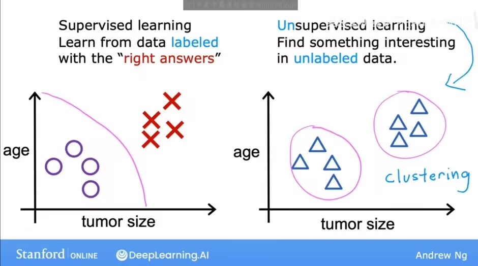

#### 3.数据、特征和标签分别是什么？训练集、验证集和测试集各有什么用途？

- 数据：样本的原始记录，机器学习的"原材料"，一条数据一般对应一个样本
- 特征：样本的属性，比如预测房价时"房子大小、房龄、房间数"就是特征，用 $\boldsymbol{x}$ 表示
- 标签：样本的"正确答案"，也就是模型要预测的目标值，比如房子真实的成交价，用 $y$ 表示

三个数据集的用途：

| 数据集 | 用途 | 类比 |
| --- | --- | --- |

| 训练集 | 用于模型调整参数、学习规律 | 平时做练习题 |
| 验证集 | 用于训练过程中调超参数、选模型、判断是否过拟合 | 模拟考 |
| 测试集 | 训练全部结束后最终评估泛化能力，绝不参与训练 | 高考 |

#### 4.batch size 是什么？有什么影响？

- batch size：一次训练前向传播+反向传播中送入模型的样本数量（全部训练数据过完一遍叫一个epoch）
- 影响：
  - batch size 大：梯度估计更准确稳定，但占用显存大，容易陷入局部最优，泛化能力可能变差
  - batch size 小：训练不稳定，震荡大，训练慢
  - 实践中常用 mini-batch（如 32/64/128），在稳定性和效率之间折中

#### 5.什么是模型和模型参数？

  - 模型：输入到输出的数学映射函数，在机器学习里，模型是通过学习数据中的规律，来对未知数据进行预测或分类等任务的算法结构

  - 工作方式：模型先通过训练数据学习，调整自身参数以拟合数据中的结构，训练完成后，当输入新的测试数据时，模型利用已学习到的参数和结构，对数据进行处理，输出预测结果

  - 模型参数：模型内部通过训练学习出来的数值（比如全连接层的权重 $\boldsymbol{W}$ 和偏置 $\boldsymbol{b}$），参数数量决定了模型的容量

  - 和超参数区分：**超参数**（如学习率、batch size、网络层数等）是人在训练前手动设定的，不通过梯度更新

#### 6.神经网络由哪些基本部分组成？什么是激活函数？为什么要激活函数？请介绍几种常见的激活函数。

- 基本组成：输入层 → 若干隐藏层 → 输出层
  每层做两件事：线性变换 $\boldsymbol{z} = \boldsymbol{W}\boldsymbol{x} + \boldsymbol{b}$ 和非线性激活 $a = f(\boldsymbol{z})$
  训练时还需要损失函数和优化器
- 激活函数：接在线性变换后面的非线性函数，使神经网络能拟合复杂函数
- 为什么要激活函数：没有它，多层网络叠起来还是线性的——$\boldsymbol{W}_2(\boldsymbol{W}_1\boldsymbol{x}) = (\boldsymbol{W}_2\boldsymbol{W}_1)\boldsymbol{x}$，再深也只等价于一层线性变换，拟合不了曲线这类非线性问题
- 常见激活函数：
  - Sigmoid：$\sigma(x) = \frac{1}{1+e^{-x}}$，将输出压缩到 (0,1)，适合二分类输出层，缺点是容易梯度消失
  - Tanh：将输出压缩到 (-1,1)，比Sigmoid好，但同样会梯度消失
  - ReLU：$\max(0, x)$，计算简单，解决梯度消失问题，是隐藏层的默认选择，缺点是负区间梯度为0，可能"神经元死亡"
  - 变体：Leaky ReLU（负区间给小斜率）、GELU（Transformer常用）

#### 7.矩阵如何求导？提前学习该部分数学。

先把偏导数、链式法则、梯度、矩阵这些基础数学过一遍：
  - 偏导数：损失函数通常是多变量函数，偏导数用于衡量函数在**某一变量方向上的变化率**，是梯度下降等优化算法中计算参数更新量的基础，帮助找到使损失函数最小的参数
  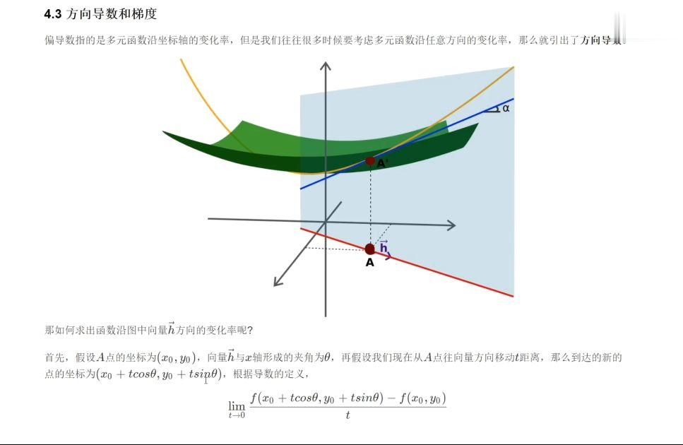
  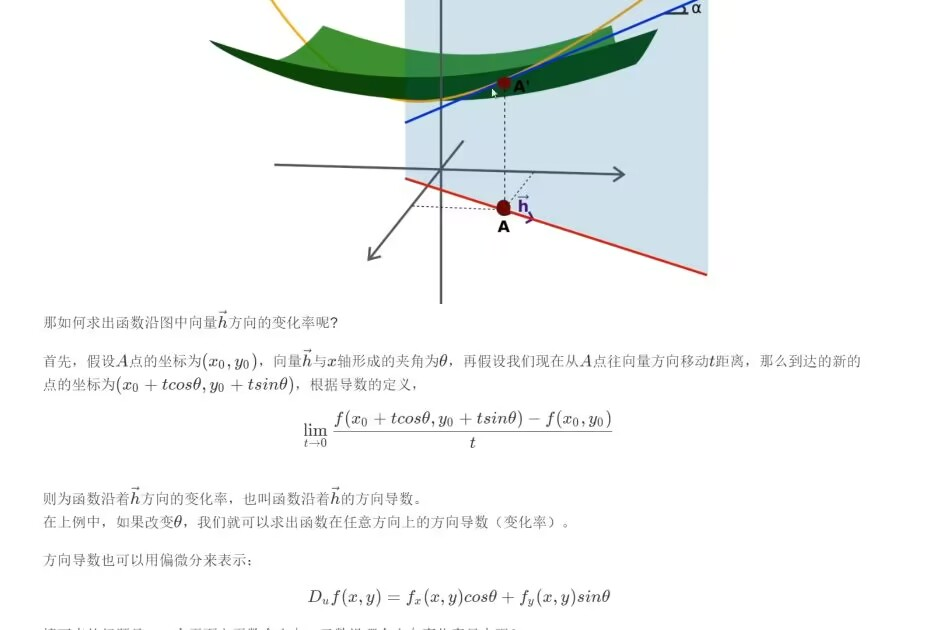
  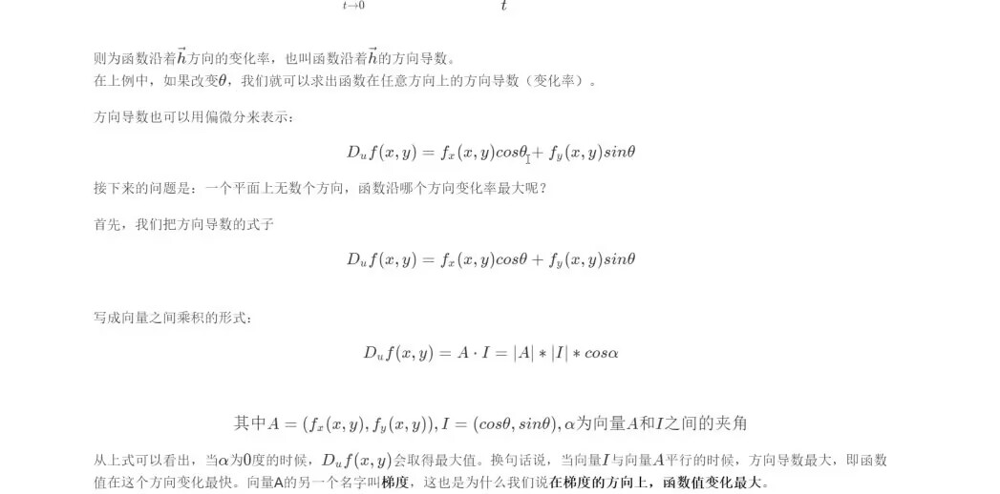

  - 链式法则：**用于计算复合函数的导数**,通过链式法则，可以高效地从输出层向输入层反向计算各层参数的梯度，从而实现参数的更新

  - 梯度：**是函数在某一点处的所有偏导数组成的向量，指向函数值增长最快的方向**，在优化算法中，沿着梯度的反方向更新参数，能使损失函数快速下降，找到最优参数。
  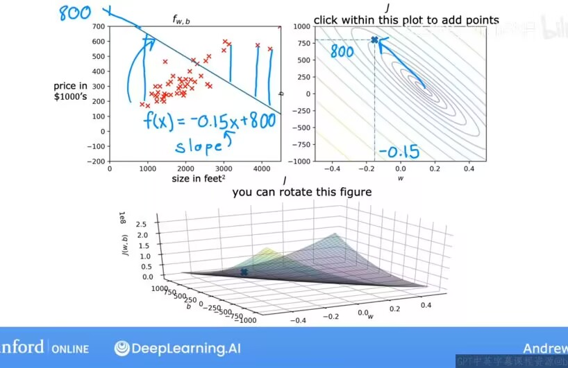

  - 矩阵：机器学习中大量数据以矩阵形式表示（如样本特征矩阵），矩阵运算可以高效地处理**高维数据**。在神经网络中，依赖矩阵乘法来实现**批量数据**的快速计算
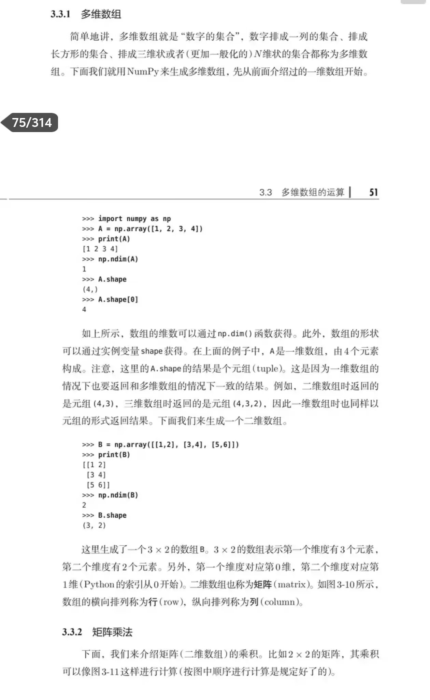

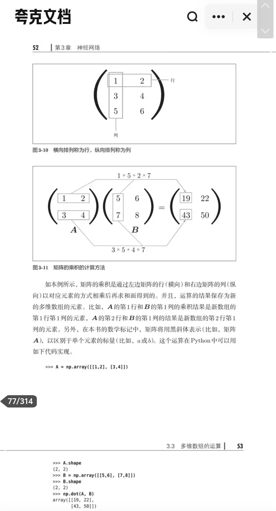
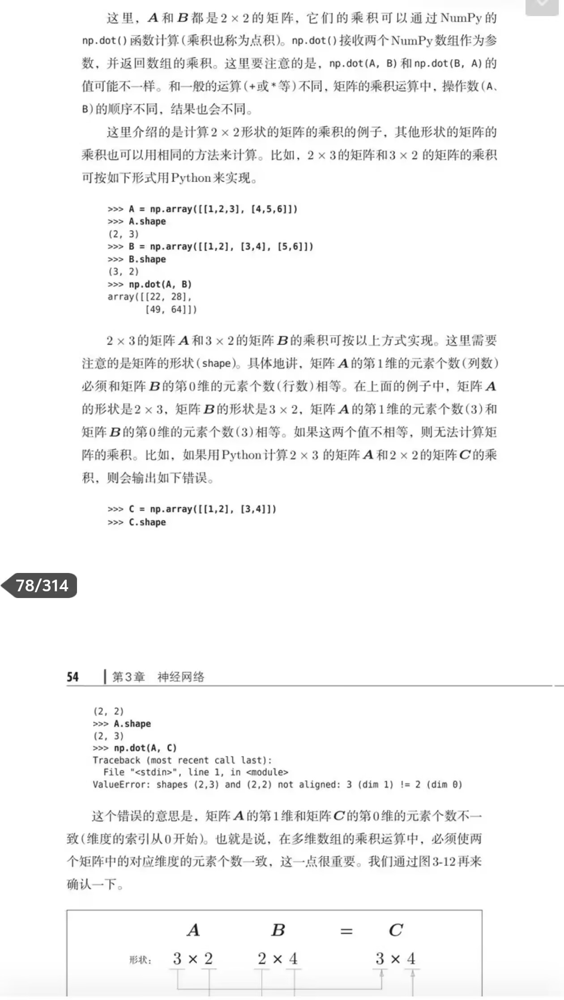

然后是矩阵求导本身：

- 基本原则：标量（损失）对矩阵/向量求导，结果与求导对象形状相同，逐元素求偏导再组装即可
- 举例：线性回归损失 $L = \frac{1}{2}\|\boldsymbol{X}\boldsymbol{w} - \boldsymbol{y}\|^2$，其中 $\boldsymbol{X} \in \mathbb{R}^{b \times n}$，$\boldsymbol{w} \in \mathbb{R}^{n}$
  - 令误差 $\boldsymbol{e} = \boldsymbol{X}\boldsymbol{w} - \boldsymbol{y}$，则 $L = \frac{1}{2}\boldsymbol{e}^T\boldsymbol{e}$
  - 用链式法则展开可得 $\frac{\partial L}{\partial \boldsymbol{w}} = \boldsymbol{X}^T(\boldsymbol{X}\boldsymbol{w} - \boldsymbol{y})$，形状与 $\boldsymbol{w}$ 相同
- 记忆技巧：把 $\boldsymbol{X}^T(\boldsymbol{X}\boldsymbol{w}-\boldsymbol{y})$ 和一维的 $x(xw-y)$ 对照着看，矩阵求导就是"批量版的标量求导"

#### 8.怎么用矩阵乘法表示神经网络的全连接层前向传播过程？

- 假设全连接层的输入为向量  $\boldsymbol{x} \in \mathbb{R}^{n}$（其中  n  是输入特征的数量），权重矩阵为$\boldsymbol{W} \in \mathbb{R}^{m \times n}$（其中  m  是该层输出神经元的数量），偏置向量为  $\boldsymbol{b} \in \mathbb{R}^{m}$

  全连接层的前向传播过程可以表示为：

  $\boldsymbol{z} = \boldsymbol{W}\boldsymbol{x} + \boldsymbol{b}$

  其中， $\boldsymbol{z}$ 是经过线性变换后的输出向量。之后， $\boldsymbol{z}$  通常会再经过激活函数（如 ReLU、Sigmoid 等），得到该层最终的输出。

  如果是批量数据（即同时处理多个样本），输入为矩阵  $\boldsymbol{X} \in \mathbb{R}^{b \times n}$（其中  b  是批量大小），那么前向传播过程为：

  $\boldsymbol{Z} = \boldsymbol{X}\boldsymbol{W}^{T} + \boldsymbol{b}$

 这里，偏置  $\boldsymbol{b}$  会通过广播机制与矩阵乘法的结果相加

*广播：使两个维度的大小相等；其中一个维度的大小为1（可以被"拉伸"到与另一个维度匹配）*|

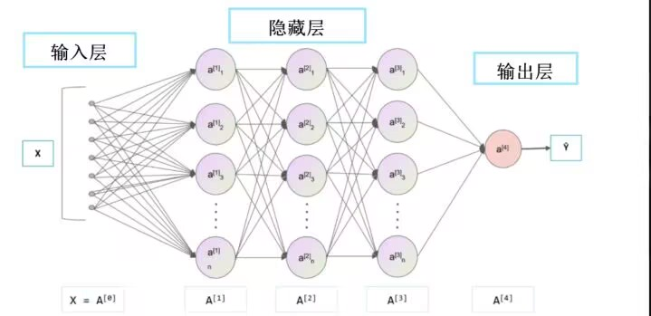

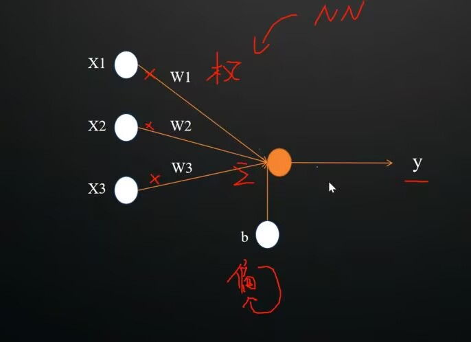

#### 9.前向传播与反向传播分别在做什么？损失函数、梯度和学习率在训练过程中扮演什么角色？

- 前向传播：输入数据从输入层经过"线性变换+激活函数"隐藏层，最终算出预测值
- 损失函数：量化预测值和真实标签差距的函数（回归常用 MSE，分类常用交叉熵损失）
- 反向传播：根据损失，利用链式法则从输出层往输入层反向逐层计算每个参数的梯度，更新网络参数
- 梯度：损失对参数的偏导数组成的向量，指向损失上升最快的方向，所以参数要朝反方向更新
- 学习率：控制每一步参数更新的步长 $\eta$，太大来回震荡甚至发散，太小收敛太慢
  一次参数更新：$\boldsymbol{w} \leftarrow \boldsymbol{w} - \eta \frac{\partial L}{\partial \boldsymbol{w}}$

#### 10.优化器是什么？有哪些？

- 优化器：根据梯度更新模型参数的算法
- 常见优化器：
  - SGD：最朴素的随机梯度下降，按上面的公式直接更新，缺点是容易震荡、收敛慢
  - Momentum：累计历史梯度形成"惯性"，能冲过震荡和小的局部坑，收敛快
  - AdaGrad / RMSProp：给每个参数自适应的学习率，更新频繁的参数步子自动变小，灵活自由
  - Adam：Momentum + RMSProp的结合体，既有惯性又能自适应调步长，是目前最常用的默认选择

#### 11.什么是过拟合，欠拟合，正则化？

- 欠拟合：模型太简单，训练集都没学好，训练误差和测试误差都高
- 过拟合：模型太复杂，把训练数据的细节和噪声都死记硬背了下来，训练误差很低但测试误差很高
- 正则化：用来抑制过拟合、提高泛化能力的手段：
  - L2 正则：损失里加 $\lambda\|\boldsymbol{w}\|^2$惩罚项，逼参数变小，模型更平滑
  - L1 正则：加 $\lambda\|\boldsymbol{w}\|_1$惩罚项，能让部分参数变0，起特征筛选作用
  - Dropout：训练时随机丢弃一部分神经元，强迫网络不依赖个别特征
  - 其他：数据增强（对数据做变换）、早停（验证集误差回升就停止训练）

---

### #搭建环境

首先我们安装一下anaconda，显然我的笔记本运行不了这么重量级的环境，所以我选择miniconda

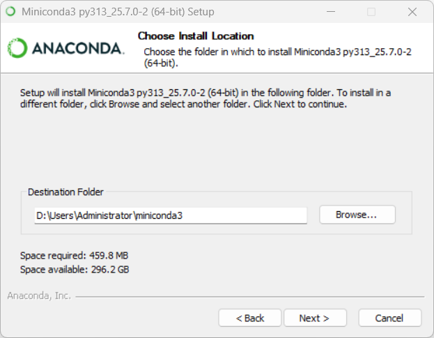

漫长的等待后我们下载一些conda常用的库，like this：

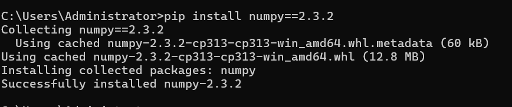

然后下载一个适合自己电脑的pytorch
我的电脑有英伟达显卡（GPU），所以可以进行深度学习

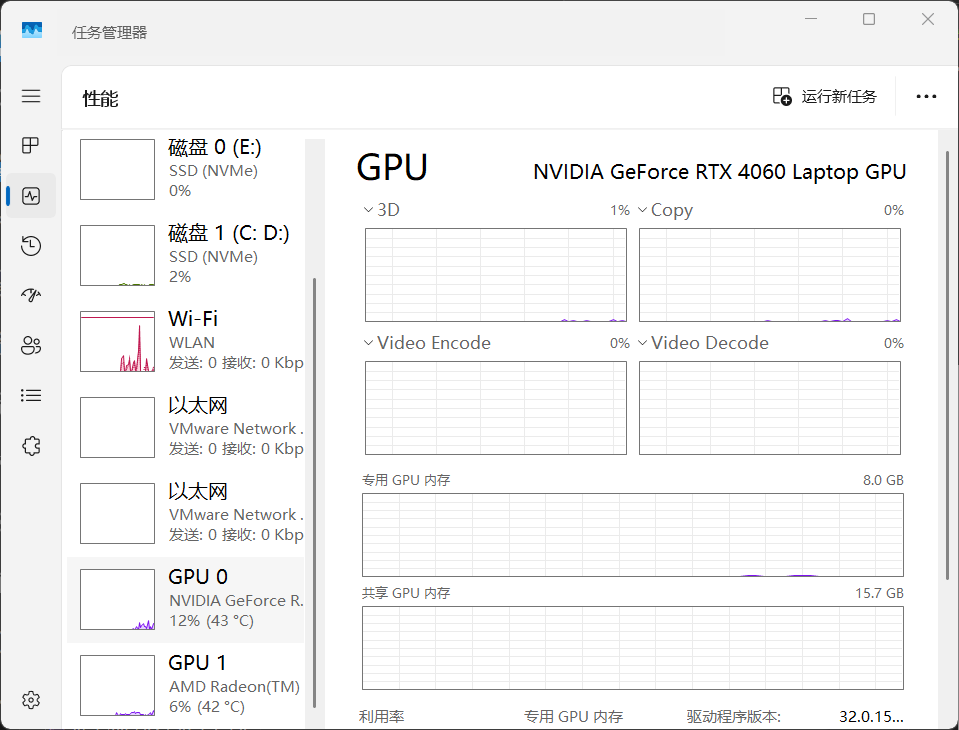

**不要选最新版本！！！它不兼容！！！**

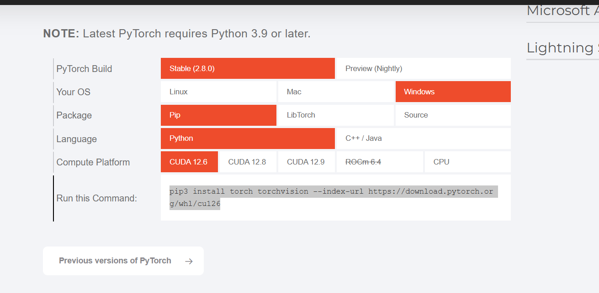

如果下载很慢很慢可以用清华源，据说快一点，但我感觉直接从官网下也不是很慢，所以我没用

清华源指令：pip3 install torch torchvision torchaudio --index-url https://pypi.tuna.tsinghua.edu.cn/simple -f https://download.pytorch.org/whl/cu121

创建一个python的虚拟环境

**一定不要用太低版本的python！！！**
惨痛教训+n
因为从官网下的pytorch是新版，如果python版本太低会报错

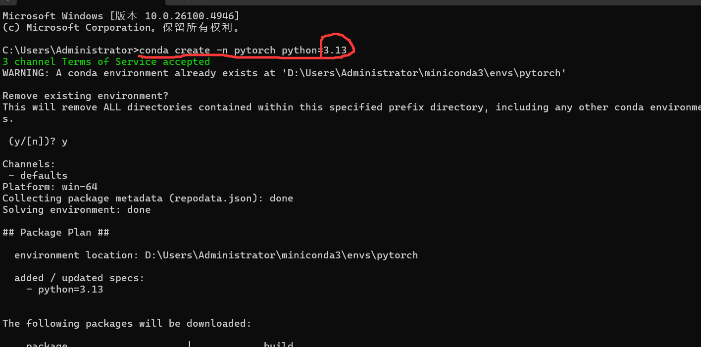

这样可以在list里看见torch就是下好了

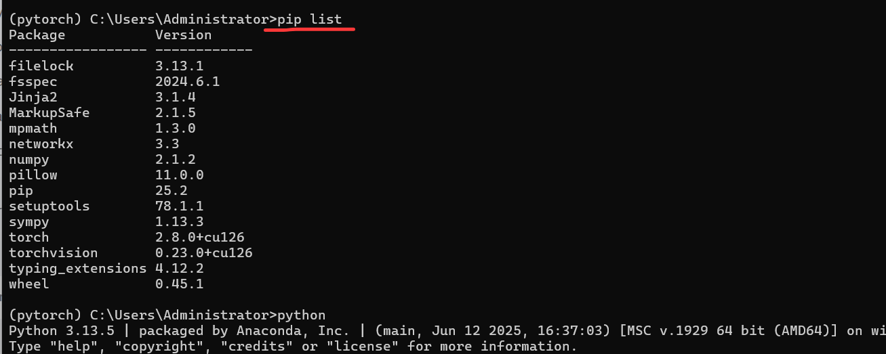

我们可以再检查一下自己有没有GPU，先进入python运行环境

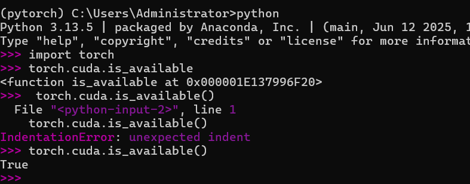

接着在vscode进入我们刚刚创建的环境中尝试一下

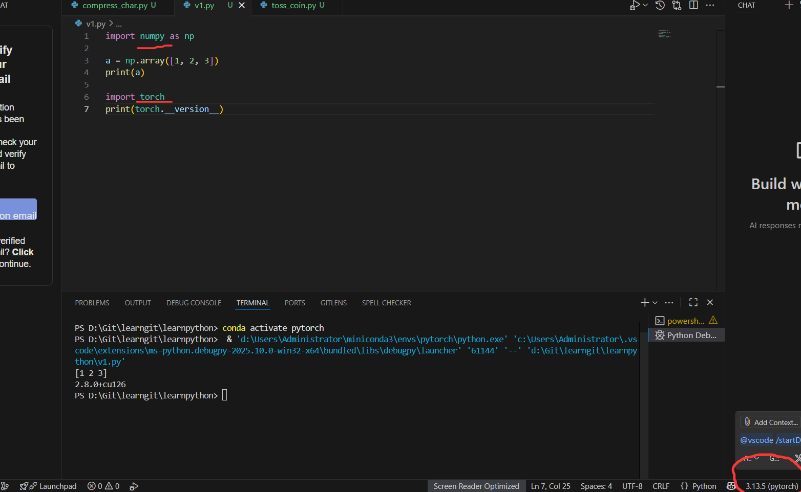

ok呀我们也是成功了

#### 环境搭建思考题

1. 为什么不同项目最好使用不同的 Python 虚拟环境？
   - 不同项目依赖的库版本经常冲突：A 项目要torch 2.x，B 项目只兼容torch 1.x，装在同一个环境里只能二选一
   - 虚拟环境把每个项目的依赖隔离开，互不干扰，某个环境坏了单独重建即可，不影响其他项目
   - 方便复现，用 `conda env export` 导出环境清单，团队其他人一条命令就能装出一模一样的环境

2. CPU 和 GPU 各自擅长什么？训练神经网络为什么经常使用 GPU？
   - 中央处理器CPU：擅长**逻辑控制、串行计算和复杂的指令调度**
     核心数少（一4-64核）般但单个核心性能强，适合处理分支预测等任务
   - 图形处理器GPU：擅长**大规模并行计算和简单重复计算**
     有上千个小核心，最开始是专门为图形渲染中矩阵运算设计的
   - 为什么使用：神经网络训练的本质是海量矩阵乘法，这些运算相互独立、天然可以并行，正好对上 GPU 的特长，所以用GPU训练能快几个数量级
3. CUDA 是什么？它、显卡驱动与 PyTorch 之间大致是什么关系？
   - CUDA：NVIDIA推出的通用并行计算架构，让程序能方便地调用GPU做通用计算
   - 层级关系（自下向上）：显卡驱动（最底层，负责操作系统与GPU硬件通信）→ CUDA Toolkit（构建在驱动之上的计算平台和API接口，提供cuDNN等加速库）→ PyTorch（调用CUDA接口，把张量运算派发给GPU执行）
   - 版本规则：安装的PyTorch CUDA版本不能高于显卡驱动支持的CUDA版本，否则会无法调用GPU

---

### #hello_ml.py 热身程序

见代码`hello_ml.py`
运行结果：

> 注：`randn` 是随机数，每次运行的 z 数值会不同，是正常的

