>这网站好玩：[Neural Network Playground](https://playground.tensorflow.org/#activation=tanh&batchSize=10&dataset=circle&regDataset=reg-plane&learningRate=0.03&regularizationRate=0&networkShape=4,2&seed=0.51895&showTestData=false&discretize=false&percTrainData=50&x=true&y=true&xTimesY=false&xSquared=false&ySquared=false&cosX=false&sinX=false&cosY=false&sinY=false&collectStats=false&problem=classification&initZero=false&hideText=false)
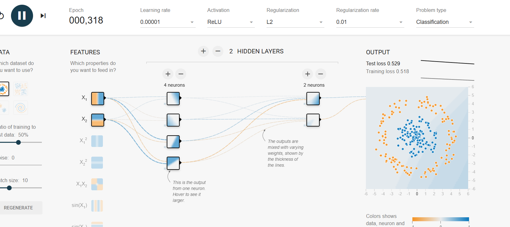


# Task 1: make_moons MLP 分类

## Task 1: 数据可视化 + 三集划分

### 数据集说明

- 使用 sklearn 的 `make_moons` 生成，1000 个样本，noise=0.15
- 按 7:2:1 划分：训练集 700 / 验证集 200 / 测试集 100
- 标准化只用训练集的 mean 和 std，避免数据泄漏（验证集和测试集的信息泄露给训练集）
- 固定随机种子 seed=42（随便一个数就行）

### 三个数据集的职责

| 数据集 | 用途 | 类比 |
|---|---|---|
| 训练集 | 训练模型参数 | 平时做作业 |
| 验证集 | 调超参数、选择最优模型、检测过拟合 | 模拟考 |
| 测试集 | 训练结束后最终评估（不参与训练） | 高考 |


- 原始数据分布图 → 运行后 `results/raw_data.png`
- 三集划分分布图 → 运行后手动截图或自行添加

---

## Task 2: MLP + 训练/验证/测试 + 模型保存/加载

### 最终选择的参数

*都是经过实验检验后的结果，包对的*
| 超参数 | 值 |
|---|---|
| 隐藏层结构 | (16, 8) |
| 激活函数 | ReLU |
| 学习率 | 0.005 |
| 优化器 | Adam |
| Batch size | 14 |
| Epoch | 100 |
| 损失函数 | CrossEntropyLoss |
| 输出层 | 2 个神经元 |

### 运行结果

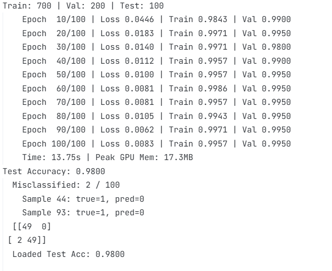

- 训练 100 epoch，Test Accuracy = 0.98
- 100 个测试样本中 2 个错误，均在月牙型交界处（边界容易混淆）
- 模型保存/加载后 Test Accuracy 一致（0.98），很稳定没啥问题

---

## Task 3: loss/accuracy 曲线 + 决策边界

### 

- Loss 与 Accuracy 曲线 → 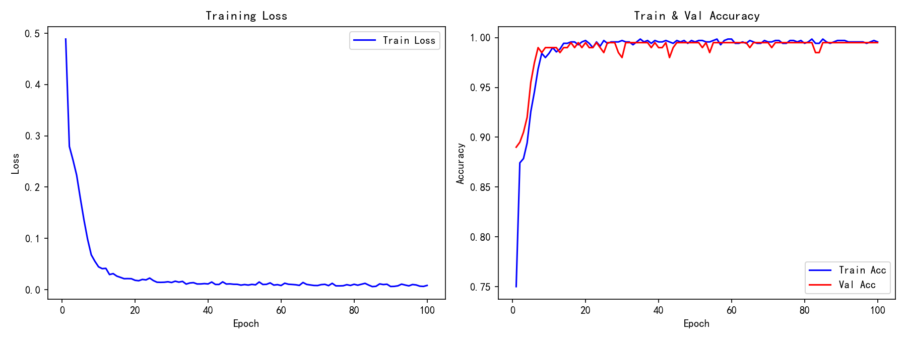
*准确率最开始很快到达了最大值，后面随着 epoch 增加，准确率开始波动，并且这种波动val比train剧烈，所以太长的epoch没啥用*
- 决策边界 → 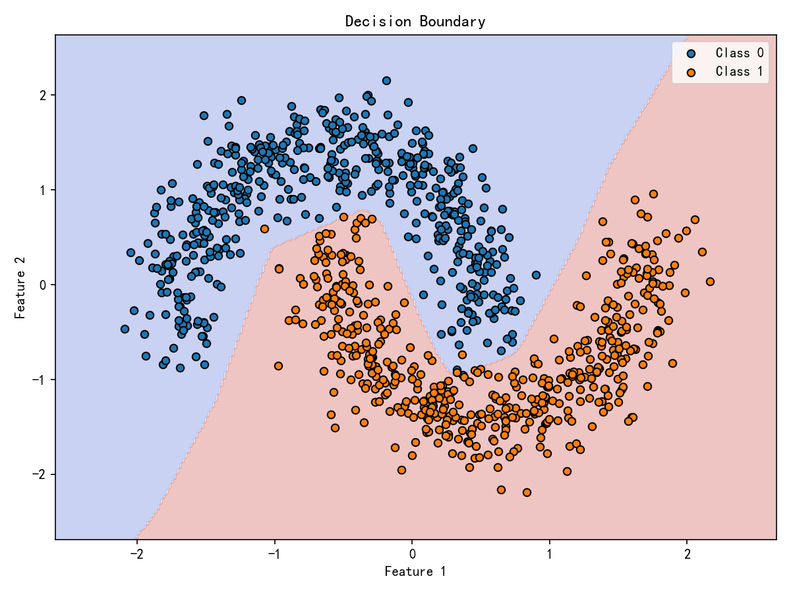
*决策边界拟合的挺好，可以看到明显的月牙形状分界，就是有两个错例（都在边界）*


---

## Task 4: 对照实验

### 实验 1：隐藏层宽度（4 / 8 / 16 / 32 / 64）

#### 分析

- 隐藏层宽度决定了模型的**表达能力上限**。宽度太小，模型容量不足，学不出复杂决策边界（就会欠拟合）；宽度足够后，继续增加也不会提升准确率，但参数更多、计算更慢。对于 make_moons 这种月牙形二分类问题，一般来说8-16个神经元应该就完全能拟合了

#### 实验结果

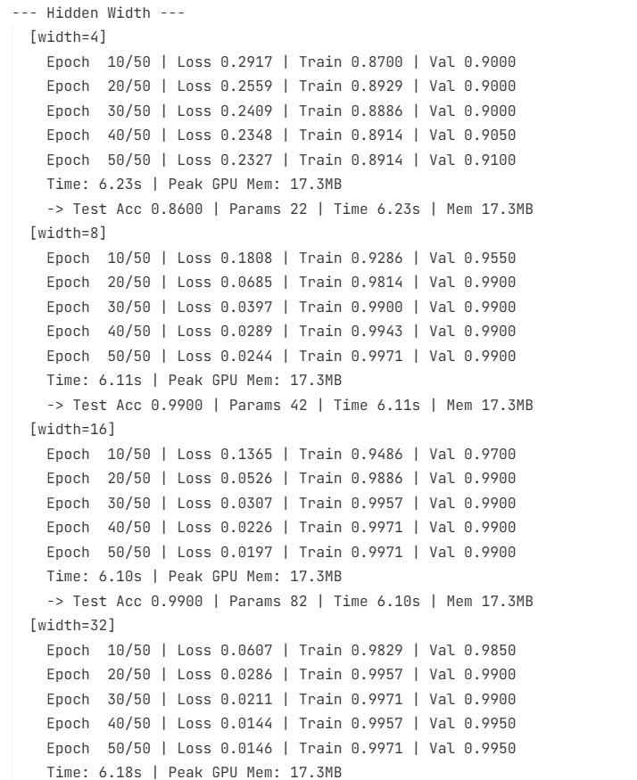
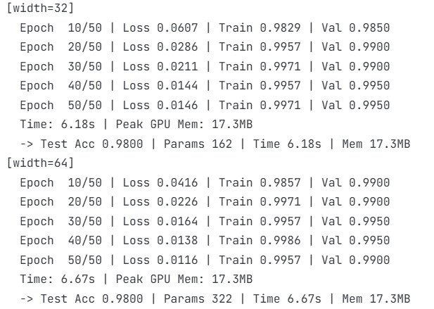

| 宽度 | Test Acc | Params | Time |
|---|---|---|---|
| 4 | 0.86 | 22 | 6.23s |
| 8 | 0.99 | 42 | 6.11s |
| 16 | 0.99 | 82 | 6.10s |
| 32 | 0.98 | 162 | 6.18s |
| 64 | 0.98 | 322 | 6.67s |

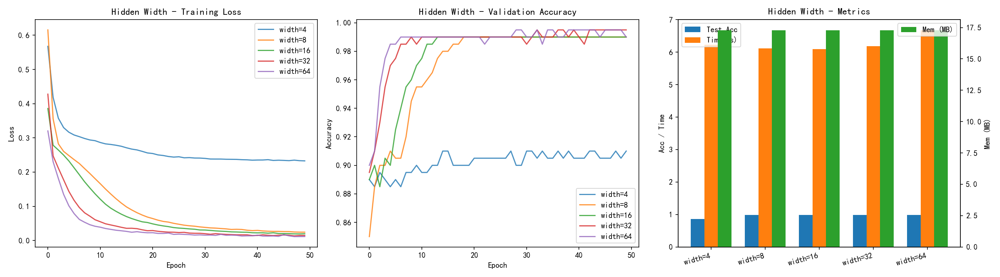

#### 结果检验理论

**理论基本是正确的，但是有细微出入**：

- ✅ 宽度=4：确实欠拟合（0.86），容量不够
- ✅ 宽度=8和16：都达到0.99，确实足够拟合月牙
- ⚠️ 但宽度=32和64反而降到0.98：理论上"够了就行，更大没坏处"，但实际上更大的宽度在50 epoch 下反而变差了一点。（因为数量小模型大可能更过拟合（？））
- ✅ 训练时间随宽度增加略有上升（6.1→6.7s），符合预期

### 实验 2：隐藏层数（1 / 2 / 3 / 4）

#### 分析

深度决定了模型能构建多复杂的特征层次。层数少的模型只能做简单线性组合，层数多可以逐层抽象出高级特征。对于 make_moons 这种简单数据，1-2 层应该足够；更深的网络面临梯度消失风险，且参数更多、计算更慢。

#### 实验结果

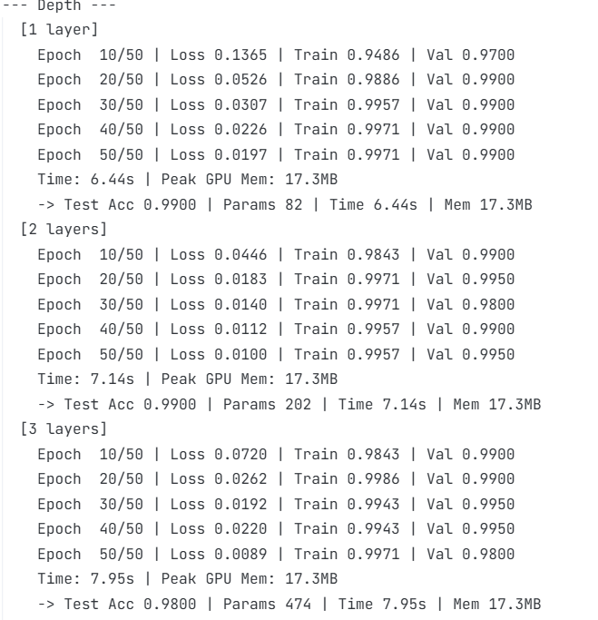
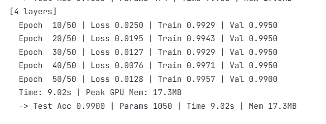

| 层数 | Test Acc | Params | Time |
|---|---|---|---|
| 1 | 0.99 | 82 | 6.44s |
| 2 | 0.99 | 202 | 7.14s |
| 3 | 0.98 | 474 | 7.95s |
| 4 | 0.99 | 1050 | 9.02s |

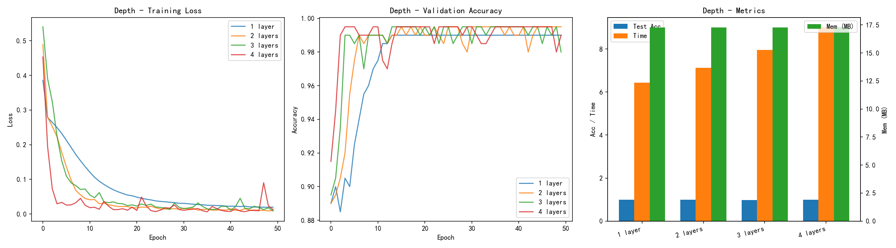

#### 结果检验理论

**理论部分正确**：

- ✅ 1 层就够拟合月牙（0.99），make_moons 确实不需要深层网络
- ✅ 更深层训练时间更长（6.4→9.0s），参数从82 跳跃到了1050
- ⚠️ 3 层反而降到 0.98，理论上更深应该至少不差，但梯度消失/训练难度可能让中间层数效果不如单层
- ⚠️ 4 层又回到 0.99，说明深度和效果不是单调关系，受训练动态影响（实际实验中有一些波动都是正常的）

### 实验 3：激活函数（ReLU / Tanh / Sigmoid）

#### 分析

- ReLU：正区间梯度恒为1，缓解梯度消失，计算简单，是隐藏层默认选择
- Tanh：输出零均值 (-1,1)，比Sigmoid好，但两端梯度仍趋近0
- Sigmoid：两端梯度趋近0，容易梯度消失，输出非零均值导致收敛慢

预期 ReLU ≈ Tanh > Sigmoid

#### 实验结果

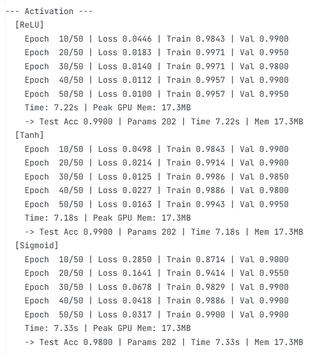

| 激活函数 | Test Acc | Time |
|---|---|---|
| ReLU | 0.99 | 7.22s |
| Tanh | 0.99 | 7.18s |
| Sigmoid | 0.98 | 7.33s |

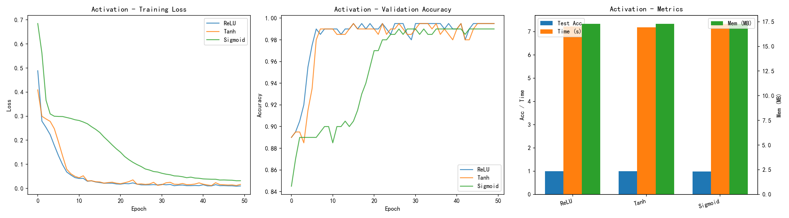

#### 结果检验理论

**理论完全正确**：

- ✅ ReLU 和 Tanh 都达到 0.99，效果最好
- ✅ Sigmoid 最低 0.98，且从 loss 曲线看前 20 epoch 收敛明显更慢
- ✅ 三者训练时间相近（7.1-7.3s），差异不显著
  （ReLU应该计算最快但这里差距不明显，因为模型太小了）

### 实验 4：学习率（0.001 / 0.005 / 0.01 / 0.05 / 0.1）

#### 分析

学习率决定参数的更新步长：

- 太小（0.001）：收敛会很慢很慢，50 epoch可能还没到位
- 太大（0.1+）：一直来回晃到达不了最优，loss 震荡，无法稳定收敛，甚至发散
- 中间值（0.005-0.05）：应该都能收敛

预期准确率呈倒U形：两端差中间好

#### 实验结果

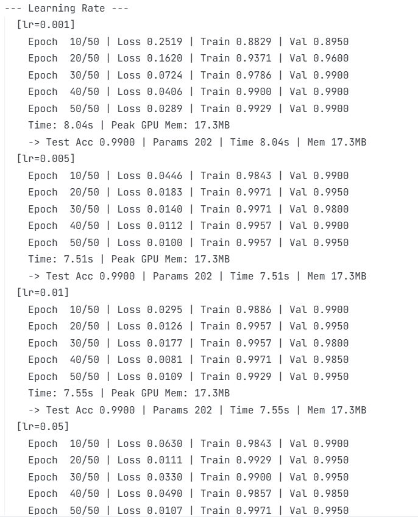
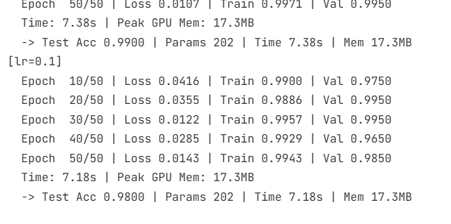

| 学习率 | Test Acc | Time |
|---|---|---|
| 0.001 | 0.99 | 8.04s |
| 0.005 | 0.99 | 7.51s |
| 0.01 | 0.99 | 7.55s |
| 0.05 | 0.99 | 7.38s |
| 0.1 | 0.98 | 7.18s |

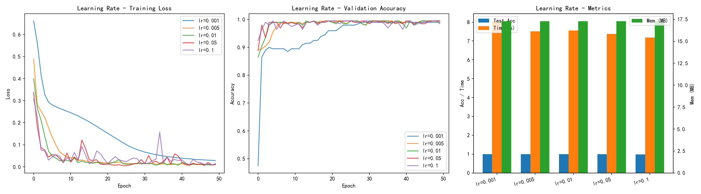

#### 理论是否正确

**理论大部分正确，但 Adam 对 lr 很宽容**：

- ✅ lr=0.1 确实最差（0.98），波动大
- ✅ 中间值 0.005-0.05 都能 0.99，基本一致
- ❌ lr=0.001 理论上应该最慢最差，但实际上也达到了 0.99——**这说明 Adam 的自适应机制让它对小 lr 也能有效**，不像 SGD 那么敏感（换成SGD应该就能看出来了）
- ✅ 训练时间随 lr 增大略有减少（8.0→7.2s），大步长走得快

### 实验 5：优化器（SGD / Adam / AdamW）

#### 分析

- SGD：最朴素的梯度下降，没有动量，收敛慢、容易震荡
- Adam：Momentum + RMSProp 结合，有惯性冲过小坑 + 自适应调步长，收敛快且稳定
- AdamW：Adam + 权重衰减，防止过拟合

预期 Adam ≈ AdamW >> SGD

#### 实验结果

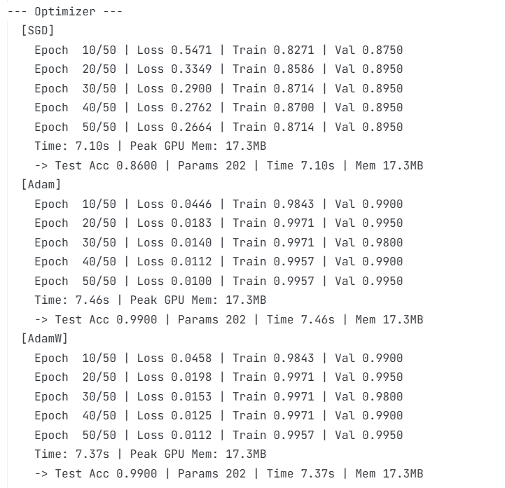

| 优化器 | Test Acc | Time |
|---|---|---|
| SGD | 0.86 | 7.10s |
| Adam | 0.99 | 7.46s |
| AdamW | 0.99 | 7.37s |

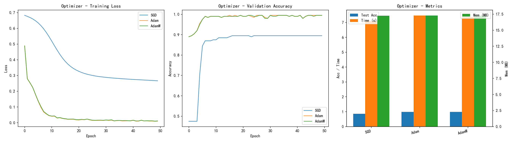

#### 结果检验理论

**理论完全正确，差距比预期更大**：

- ✅ SGD 在 50 epoch 后仍只有 0.86，收敛真的很慢
- ✅ Adam 和 AdamW 瞬间收敛到 0.99，差距巨大
（AdamW 这里没有比 Adam 更好——因为数据太小、模型太简单，几乎没有过拟合问题，权重衰减起不到什么作用）
- ✅ 训练时间三者相近，主要差异在收敛速度

### 实验 6：Batch Size（8 / 16 / 32 / 64 / 128）

#### 分析

- 大 batch：梯度估计准、GPU 并行度高、训练快，但泛化能力略差
- 小 batch：有正则化效果（噪声帮助跳出局部最优）、泛化好，但训练慢
- 实践中常用 32-128 的 mini-batch 折中

预期：大 batch 更快，但准确率可能略低

#### 实验结果

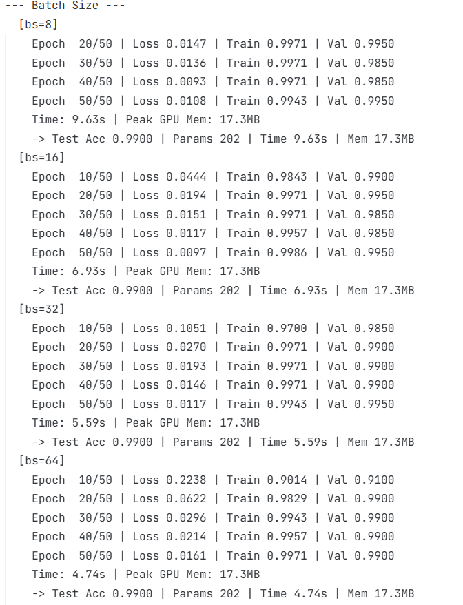

| Batch Size | Test Acc | Time |
|---|---|---|
| 8 | 0.99 | 9.63s |
| 16 | 0.99 | 6.93s |
| 32 | 0.99 | 5.59s |
| 64 | 0.99 | 4.74s |
| 128 | 0.99 | — |

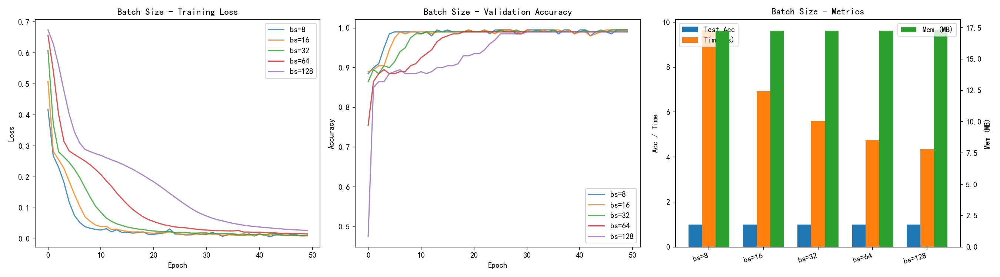

#### 结果检验理论

**理论部分正确**：

- ✅ 训练时间随 batch size 增大单调下降（9.6→4.7s），GPU 并行加速明显
- ❌ 准确率完全一致（都是 0.99）（还是这个数据太简单，差异体现不出来）
- 这说明了 batch size 主要影响**训练效率**，对简单任务的泛化影响不大

### 实验 7：数据噪声（0.0 / 0.1 / 0.2 / 0.3）

#### 分析

噪声越大，数据点越分散，类别边界越模糊，模型越难拟合。noise=0 时月牙完美分离，应该近于100%；noise=0.3 时边界严重重叠，准确率显著下降。

#### 实验结果

| 噪声 | Test Acc | Time |
|---|---|---|
| 0.0 | 1.00 | — |
| 0.1 | 1.00 | — |
| 0.2 | 0.97 | — |
| 0.3 | 0.90 | — |

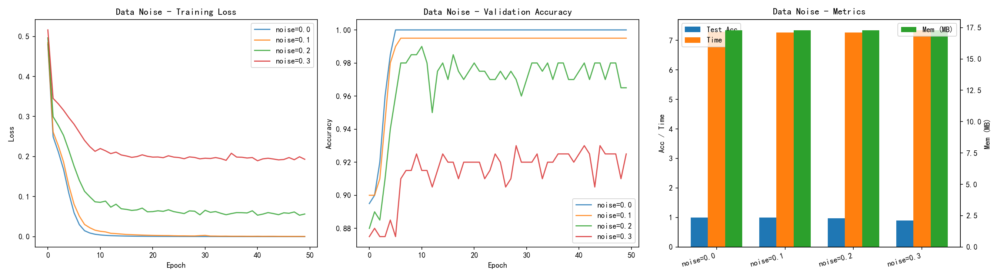
*噪声越大，曲线波动越明显*
#### 结果检验理论

**理论完全正确**：

- ✅ noise=0 和 0.1 都 100%，边界清晰
- ✅ noise=0.2 降到 0.97，开始有边界重叠
- ✅ noise=0.3 降到 0.90，大量噪声点跨越边界
- 噪声是这几个实验中对准确率影响**最显著**的因素，因为它直接改变了数据本身的可分类性

---

## Task 5: 混淆矩阵 + 错误样本

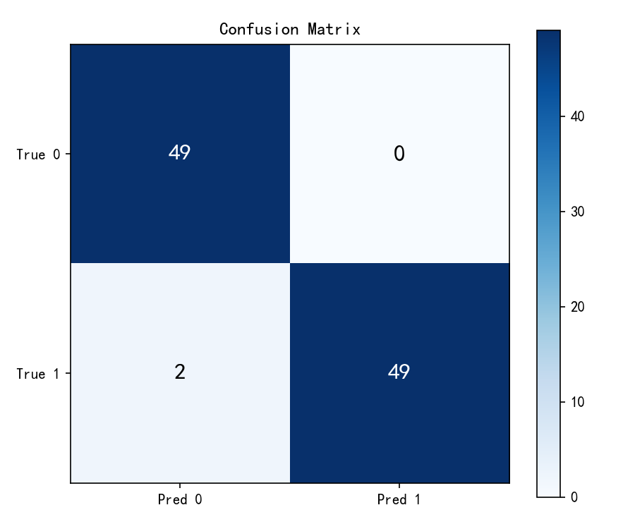
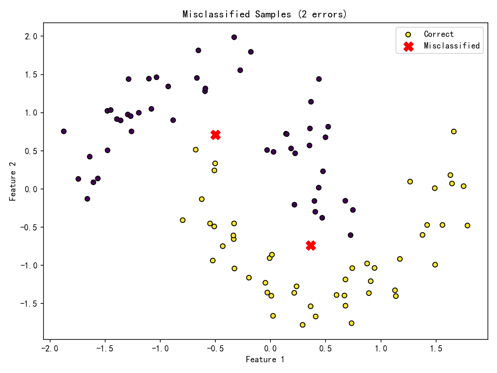

### 混淆矩阵分析

```
[[49  0]
 [ 2 49]]
```

- True 0 → Pred 0: 49 个（正确）
- True 0 → Pred 1: 0 个
- True 1 → Pred 0: 2 个（错误）
- True 1 → Pred 1: 49 个（正确）

### 错误样本分析

2 个错误样本都是**真实标签为 1 但被预测为 0**，位于两个月牙的**交界处**（边界模糊区域），是噪声引入的不可避免的误差。（但挺少的可以接受）

---

## 总结

### 理论 vs 实验结论

大部分超参数的理论预期和实验结果**一致**，但有几个值得注意的偏差：

1. **Adam 对学习率特别宽容**——理论上 lr=0.001 应该慢，但实际上 Adam 用 0.001 也能快速收敛，这是 Adam 自适应机制的好处
2. **大宽度不一定更好**——理论说"够了就行，更大没坏处"，但 32-64 宽度反而略降，可能是少样本下大模型泛化更差
3. **Batch Size 对准确率几乎无影响**——理论说大 batch 泛化略差，但简单任务上差异基本可以忽略
4. **噪声是最显著因素**——这个实验的模型容量都远大于数据复杂度，所以模型相关参数影响都小，数据本身的可分类性才是瓶颈

---

## 思考题

### 1. 选择了什么激活函数？为什么？

**理论分析**：隐藏层需要非线性变换才能拟合月牙，Sigmoid/Tanh 两端梯度趋近 0 容易梯度消失，ReLU 正区间梯度恒为 1，计算简单且缓解梯度消失，是隐藏层**默认选择**
**输出层不加激活，因为 CrossEntropyLoss 内部已做 log_softmax**

**实验验证**：


| 激活函数 | Test Acc |
|---|---|
| ReLU | 0.99 |
| Tanh | 0.99 |
| Sigmoid | 0.98 |


**验证**：ReLU 和 Tanh 都达到 0.99，Sigmoid 收敛最慢（前 20 epoch loss 0.28 vs ReLU 0.04），最终只有 0.98
**所以我选择了 ReLU**

---

### 2. 选择了什么损失函数？为什么？如果是三分类呢？

**理论分析**：二分类任务用 CrossEntropyLoss，内部集成 log_softmax + NLLLoss
输出层 2 个神经元 + CrossEntropyLoss 等价于二元交叉熵
如果是三分类，损失函数不变，只需输出层改为 3 个神经元，标签用 0/1/2 整数形式（把输出改成3就完了）

**验证**：最终模型 Test Acc 0.98，训练 loss 降到 0.008，损失函数工作正常

---

### 3. zero_grad / backward / step 分别做了什么？不清空梯度会怎样？

**理论分析**：
- `optimizer.zero_grad()`：清空上一批的梯度。PyTorch 梯度默认累加，不清空会导致当前 batch 梯度叠加到之前 batch，参数更新方向错误
- `loss.backward()`：反向传播，链式法则从损失出发逐层计算每个参数的梯度，结果存到 `.grad` 里面
- `optimizer.step()`：根据梯度和优化器策略更新参数

**验证**：跑训练脚本，清空梯度后参数正常更新，loss 下降、
如果注释掉 `zero_grad()`，梯度会跨 batch 累加，loss 会震荡甚至爆炸（我试了一下很惨不忍睹）。


---

### 4. 更深更宽一定更好吗？

**理论分析**：深度/宽度决定模型容量。容量不足会欠拟合；容量够了继续增加会参数过多、训练慢，简单任务上不一定更好，极端时还会过拟合。

**验证**：


| 宽度 | Test Acc | | 层数 | Test Acc |
|---|---|---|---|---|
| 4 | **0.86** | | 1 | 0.99 |
| 8 | 0.99 | | 2 | 0.99 |
| 16 | 0.99 | | 3 | 0.98 |
| 32 | 0.98 | | 4 | 0.99 |
| 64 | 0.98 | | | |

**这种简单数据 1-2 层就够，更深更宽只增加训练时间和参数，没有任何意义**

---

### 5. 学习率过大或过小会怎样？

**理论分析**：学习率决定步长。太小（0.001）收敛极慢，50 epoch 可能没到位；太大（0.1+）loss 震荡无法稳定收敛。中间值都能收敛。

**实验验证**：


| lr | Test Acc |
|---|---|
| 0.001 | 0.99 |
| 0.005 | 0.99 |
| 0.01 | 0.99 |
| 0.05 | 0.99 |
| 0.1 | **0.98** |

**理论是否正确**：⚠️ 大部分正确但有惊喜。lr=0.1 确实最差（0.98，loss 波动大）。但 lr=0.001 理论上应该最慢最差，实际上 Adam 用 0.001 也在 50 epoch 内收敛到 0.99——**Adam 的自适应机制让它对小 lr 特别宽容**，不像 SGD 那么敏感。这也解释了为什么实践中 Adam 不需要像 SGD 那样精心调 lr。

---

### 6. 类别不均衡会怎样？

**理论分析**：模型会偏向多数类。如果90%都是 class 0，模型全猜0就能得90%准确率，但少数类召回率为0
准确率在不均衡数据上是**误导性指标**，应该看 Precision/Recall/F1 或混淆矩阵。

**验证**（class 0: class 1 = 50:1）：


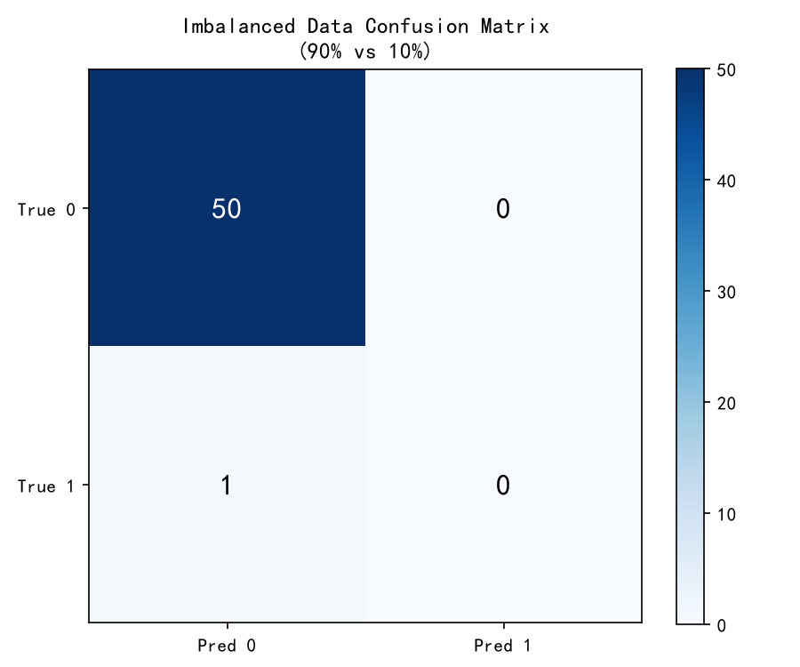

看起来效果特别好，跟我们正常实验数据的结果差不多，实际上它就是把是所有样本判断为 class 0，你根本看不出它能否检测class 1样本

所以，**准确率在不均衡数据上毫无意义**，必须看混淆矩阵、Precision/Recall/F1**

---

### 7. 故意过拟合会怎样？

**理论分析**：让模型极度复杂（大模型 + 少训练样本 + 不做正则化 + 训够轮数），训练集能到100%，但验证集/测试集准确率更低。

理想下：
- loss 曲线：训练 loss持续下降到0，但验证 loss 先降后升（U 型拐点）
- 决策边界：过度曲折，把每个训练点都单独围住。

**实验验证**（5 层 × 256 宽度，100 个训练样本，模型 124354 参数 vs 正常模型 202 参数）：

```
Overfit model params: 124354 (vs normal 202)
Overfit Train Acc: 1.0000
Overfit Val Acc:   0.9750
Overfit Test Acc:  0.9957
```

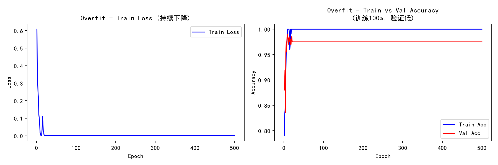

训练 loss 从 0.0017 降到 0.0000 后锁死，Val Acc 从 0.985 降到 0.975 后也锁死，而锁死是典型的过拟合信号
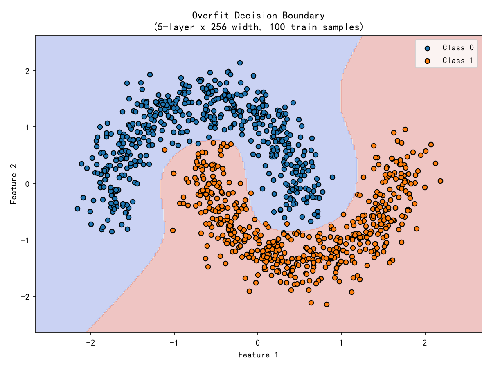

可以对比一下正常模型的决策边界：


*还是很明显的，决策边界比正常模型更扭曲*

**有趣的是**：这个过拟合模型的 Test Acc 反而有 0.9957，比正常模型的 0.98 还高
这是因为什么呢？我猜是因为数据集太小了，可能过拟合的细节“瞎猫碰上死耗子”，也代表了测试集数据的一些细节，导致 Test Acc 高

**这个数据集还是太小了，应该用大数据集进行尝试，可能会更准确**