# CNN 猫狗分类

## 实验 1：手搓卷积核

### 1. 像素、RGB、灰度/彩色

- 像素（Pixel）：图片的最小单位，包含亮度信息，一般用整数表示，值域 0-255
- RGB：红绿蓝三原色，通过这三种原色的组合，可以表示出几乎所有颜色
- 灰度图：单通道，表示明暗（一般是二维矩阵）
- 彩色图：三通道 RGB（一般是三维张量）

### 2. Pillow → NumPy → Tensor

使用题目给出的公路图（`highway.jpg`，原始尺寸 960×540）：

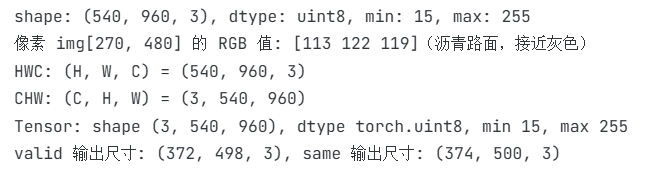

- 每个维度：H=高（行数）、W=宽（列数）、C=通道数（RGB=3）
- 数值含义：每个通道 0-255，0 最暗、255 最亮，三个通道分别表示红/绿/蓝强度
- HWC：Pillow/NumPy/OpenCV 默认，人读方便
- CHW：PyTorch 默认，GPU 对同一通道整片做卷积并行度高

### 3. 卷积核是什么

卷积核是一个小矩阵（如 3×3），里面的数值是权重
在图片上按照设定的步长stride从左到右、从上到下滑动，每到一个位置就与覆盖的像素区域做**逐元素相乘再求和**，得到输出特征图的一个像素
公式：`g(i,j) = ΣΣ f(i+m, j+n)·k(m,n)`。

在真实猫图上找到一个对比最强的边缘区域（中心坐标 (100,310)，灰度值）：

```
3×3 邻域像素：           均值核：
169  144  125           1 1 1
121  103   91    ×      1 1 1    /9
 78   70   69           1 1 1
```

手写卷积使用双重循环遍历每一个像素，对每个位置提取像素值，与卷积核逐元素相乘，求和，得到输出特征图的一个像素：

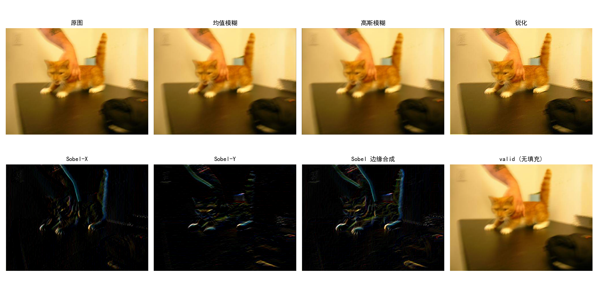

- 均值模糊：`(169+144+…+69)/9 = 107.78`（中心原像素103，现在被周围平均，差异被抹平）
- 高斯模糊：高斯核 `[[1, 4, 6, 4, 1], [4, 16, 24, 16, 4], [6, 24, 36, 24, 6], [4, 16, 24, 16, 4], [1, 4, 6, 4, 1]]`：`5×103−(144+121+91+70) = 89`（对中心权值最高，离中心越远影响越小）
- 锐化：锐化核 `[[0,-1,0],[-1,5,-1],[0,-1,0]]`：`5×103−(144+121+91+70) = 89`（中心原像素被周围差异放大，差异被放大）
- Sobel边缘检测：分别使用Sobel-X核和Sobel-Y核检查谁水平、垂直方向的梯度变化，合成计算两个方向的梯度平方和的平方根，得到`-113`，绝对值很大 → 该点正处于一条边缘上，与选点时"局部对比度最大"一致，验证了卷积核的物理含义

结果分析：

| 核类型 | 核结构 | 图上实测效果 |
|---|---|---|
| 均值模糊 3×3 | 9 个权重全为 1/9，权重和=1 | 猫毛纹理细节被抹平，整体柔和 |
| 高斯模糊 5×5 | 中心权重高、向四周递减，权重和=1 | 同样模糊但边缘过渡更自然，无均值模糊的轻微"重影" |
| 锐化 | 中心 5、四邻域 −1，权重和=1 | 胡须、身体轮廓、猫眼边缘对比明显增强 |
| Sobel-X/Y | 左右（上下）差分 | 猫轮廓被提取为亮线，合成图 √(gx²+gy²) 得到完整边缘 |


### 7. valid vs same padding

实测（3×3 核作用于 374×500 真实图）：


可以看到valid输出尺寸为H-2、W-2，same输出尺寸为H、W，与原图一致

用公式 `out = (H + 2p − k) / s + 1` 验证一下子：

- valid（p=0）：(374−3)/1+1 = **372**，(500−3)/1+1 = **498**，和输出尺寸一致 
- same（p=1）：(374+2−3)/1+1 = **374**，(500+2−3)/1+1 = **500**，和输出尺寸一致

| padding | 输出尺寸 | 边缘像素 |
|---|---|---|
| valid | (H-k+1, W-k+1) | 核滑不出边界，边缘1圈像素无法作为中心像素参与计算，丢失边缘信息 |
| same | (H, W) | 边界外补 0，每个原像素都能当中心，尺寸保留，但代价是边缘引入了人工0值的误差 |

---

## 实验 2：猫狗分类 CNN

### 1. 数据集观察

Kaggle Dogs vs Cats：
- `train/`：25000 张，猫 12500（`cat.*.jpg`）+ 狗 12500（`dog.*.jpg`），文件名直接带有标签
- `test1/`：12500 张，文件名为 `1.jpg`~`12500.jpg`，**无标签**，只能用于推理演示，不能评估准确率
- 图片尺寸不一、清晰度和拍摄背景大多都不一样，有室内/室外、近景/远景、多动物同框等不同的情况
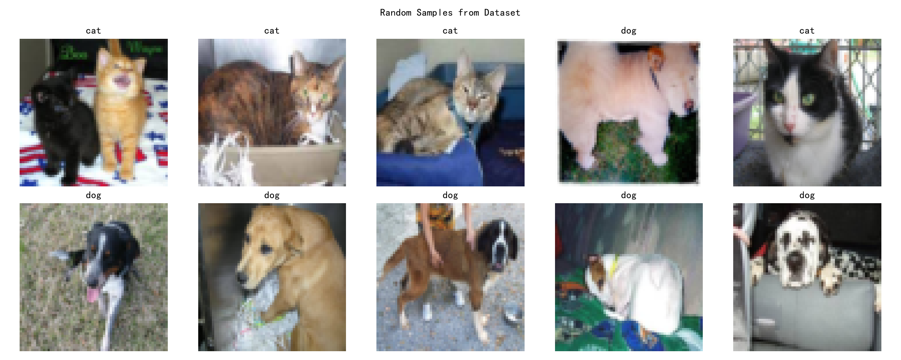

> *（正好随机采样猜到了才发现，不知道还有没有）*
> 发现：数据集中混有 1 张损坏的占位图 `dog.8898.jpg`——内容其实是 Kaggle 的 "No Photo Available" 棕色剪影，仅 3505 字节，却被当作 dog 样本
> 它落在测试集、未进训练集，因此不影响训练，但展示样本/错误样本时一定要剔除

因此从 `train/` 的 25000 张中固定种子随机划分为 **训练 20000 / 验证 2500 / 测试 2500（8:1:1）**，保证测试集有真实标签可评估准确率，`test1/` 暂时不使用，仅用于推理演示（`test.jpg`就是从里面随机取出来的）

### 2. 数据读取与预处理

- 按文件路径用 Pillow 读图 → convert('RGB') → transforms 变换 → Tensor
- 标签从文件名前缀解析：`cat` → 0，`dog` → 1
- **训练集**：Resize(64,64) + 随机水平翻转 + 随机裁剪(padding=4) + 颜色扰动 + ToTensor
- **验证/测试集**：只做 Resize + ToTensor（不做数据增强）
- ToTensor 自动把 HWC 的 [0,255] uint8 转成 CHW 的 [0,1] float（就是我们在`conv2d.py中自己写的那个）
- 每次运行调用`loader_data.py`，`cnn.py` / `evaluate.py` / `aug_compare.py` 都从这里导入，保证每个任务用的是**同一份划分、同一套预处理**

**怎么组成一个 batch**：`__getitem__` 每张图输出一个 `(3,64,64)` float32 张量，`DataLoader` 把 64 张图沿第 0 维堆叠成 `(64,3,64,64)`，标签堆成 `(64,)`

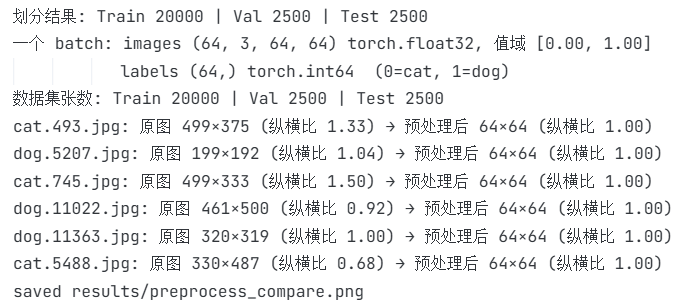

**预处理前后对比**（随机抽 6 张：上排原图保持原始尺寸，下排为预处理后的 64×64）：

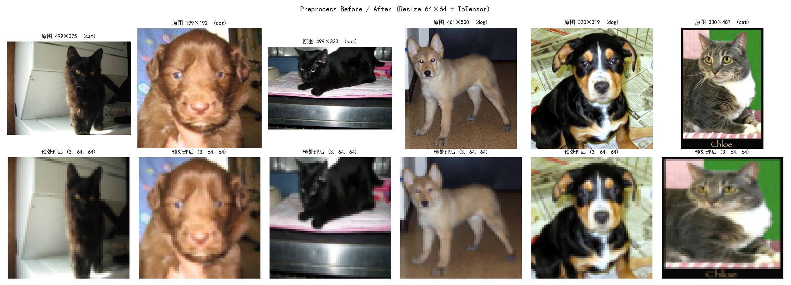

| 图 | 原图尺寸 | 纵横比 | 预处理后 |
|---|---|---|---|
| cat.493 | 499×375 | 1.33 | 64×64 |
| dog.5207 | 199×192 | 1.04 | 64×64 |
| cat.745 | 499×333 | 1.50 | 64×64 |
| dog.11022 | 461×500 | 0.92 | 64×64 |
| dog.11363 | 320×319 | 1.00 | 64×64 |
| cat.5488 | 330×487 | 0.68 | 64×64 |

- **拉伸**：显然**存在**，数据集纵横比从 0.68 到 1.50 不等，但我们把它们统一压成64x64的大小，画面被横向或纵向拉伸（如 cat.745 明显变窄、cat.5488 明显变扁）
  这是为简化流程采取的权宜之计，如果非要追求零失真，应改成**短边缩放到 64 + 中心/随机裁剪 64×64**
  *但我们训练的时候本来就要做一些数据增强，我个人觉得没有必要*
- **裁剪错误**：**无**，只在训练集做裁剪`RandomCrop(64, padding=4)` 先把 64×64 四周各补 4 像素成 72×72，再随机取 64×64，最多平移就相差 ±4 像素，不会影响主体部分
- **颜色异常**：**无**，下排颜色与上排一致、没有通道错位

### 3-4. CNN 结构与每层 Tensor 形状

真实运行打印（输入一张 1×3×64×64 的图）：

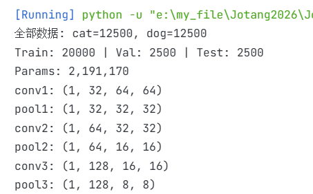

```
conv1: (1, 32, 64, 64)    ← Conv2d(3→32, k=3, p=1)，尺寸不变，通道 3→32
pool1: (1, 32, 32, 32)    ← MaxPool2d，宽高都减半
conv2: (1, 64, 32, 32)    ← 通道 32→64
pool2: (1, 64, 16, 16)    ← MaxPool2d，宽高都减半
conv3: (1, 128, 16, 16)   ← 通道 64→128
pool3: (1, 128, 8, 8)     ← 展平后 128×8×8 = 8192
fc1: 8192 → 256              ← FC 层，256 个神经元
fc2: 256 → 2                  ← FC 层，2 个神经元，对应猫狗二分类
```
模型总参数量：**2,191,170**（已经很多了（ovo））

### 5. 特征图可视化（浅层 vs 深层）

第一层卷积（32 个通道，展示了 16 个）：

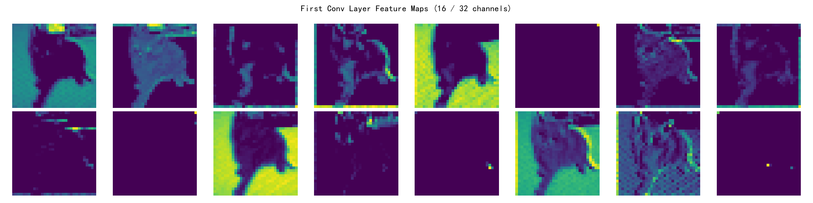

最后一层卷积（128 个通道，展示了 16 个）：  

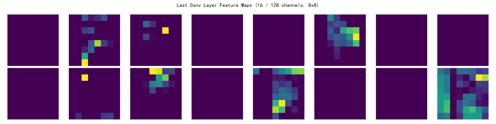

我们的预期是"浅层提取边缘/纹理、深层提取抽象语义"
用可视化图 + L2 范数（见拓展 2）来验证猜测：

- **浅层稠密、信号强**：首层 32×32 特征图上仍能清楚看出猫的轮廓，各通道分别在面部细节、身体边界、亮暗斑块处发亮
  L2 范数 mean=2.142、max=12.1，32 个通道里只有 6 个静默（<0.1），大部分通道都在工作。
- **深层稀疏、语义化**：末层分辨率只有 8×8，图像中已经看不出"猫的样子"了
- 128 个通道中 **92 个（72%）范数 <0.1 处于静默**，整体 mean 仅 0.108，只有少数通道在亮，对应与"猫"相关的高级特征组合
- 验证了我们的预期：网络从首层"几乎每个通道都在描述底层信号"，逐步变成末层"只点亮与当前类别相关的少数语义通道"

### 6. 数据增强对照

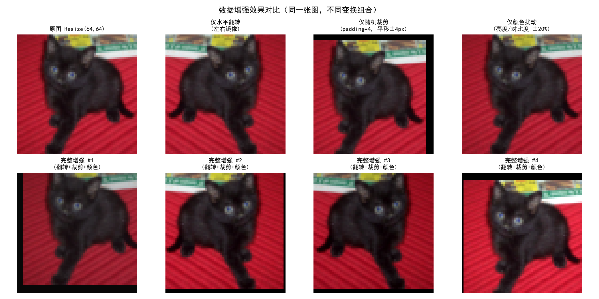
*我们做了一些数据增强*

**有增强 vs 无增强对照实验**（同种子、同划分、同超参数，仅训练数据预处理不同，各跑了 5 epoch）

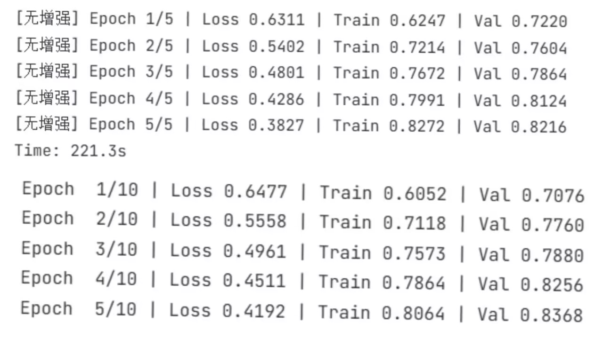

| Epoch | 无增强 Train | 无增强 Val | 有增强 Train | 有增强 Val |
| :---: | :----------: | :--------: | :----------: | :--------: |
|   1   |    0.6247    |   0.7220   |    0.6052    |   0.7076   |
|   2   |    0.7214    |   0.7604   |    0.7118    |   0.7760   |
|   3   |    0.7672    |   0.7864   |    0.7573    |   0.7880   |
|   4   |    0.7991    |   0.8124   |    0.7864    | **0.8256** |
|   5   |    0.8272    |   0.8216   |    0.8064    | **0.8368** |

**实测结论：**

- **前期增强拖慢拟合**：从epoch 1 无增强 val 0.7220 > 有增强 0.7076，到 epoch 3 无增强训练准确率一直更高，增强每轮把图片随机变形，等效于扩大了数据分布，模型拟合更困难了
- **后期增强反超**：epoch 4、5 有增强 val 0.8256/0.8368 连续高于无增强 0.8124/0.8216
  同时无增强的 epoch 5 就开始Train > Val，开始出现训练集泛化好但训练集反而没那么好的过拟合苗头，而有增强模型 train 始终低于 val
  所以**数据增强雀氏可以抑制过拟合**

> **说明**：我们一般认为“训练越久差距越大”，但本次因为时间问题未跑 10 epoch 无增强对照，还缺乏一些说服力

**增强方式合理性（标签不变性原则）：**

- **随机水平翻转**：猫狗左右对称，翻转后仍是完全相同的图像，合理且最常用
- **随机裁剪(padding=4)**：在四周补 4 像素再裁回 64，模拟取景位置的小幅移动，不会影响主体
- **颜色扰动(±0.2)**：只调亮度/对比度，模拟不同光照条件，因为猫狗毛色各种各样，模型不应该靠毛发颜色下判断
- 会破坏标签的变换：垂直翻转（猫狗不会倒立）、大角度旋转、过强裁剪、极端颜色抖动（可能让黑猫变白猫类似的特征消失），均未使用（相当于**过大的变换和不符合实际的变换**我们都不会采用）

### 7. 训练结果与错误样本分析

超参数：Adam lr=1e-3，batch_size=64，10 epoch，CrossEntropyLoss，RTX 4060 训练 1740s

输出结果：
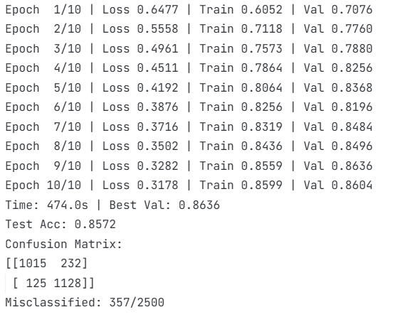

可视化：
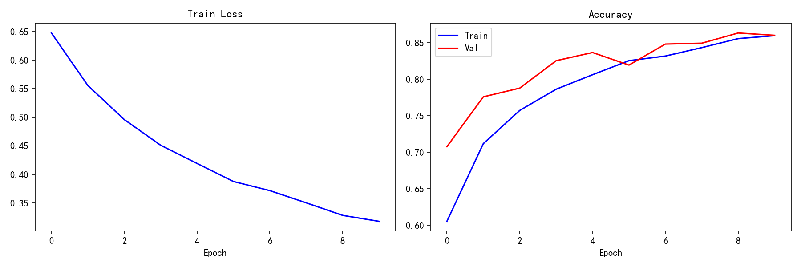


保存验证集最高的 epoch 9 权重
测试集（2500 张）结果：**Test Accuracy = 0.8572**（与 val 0.8600 差 0.048）

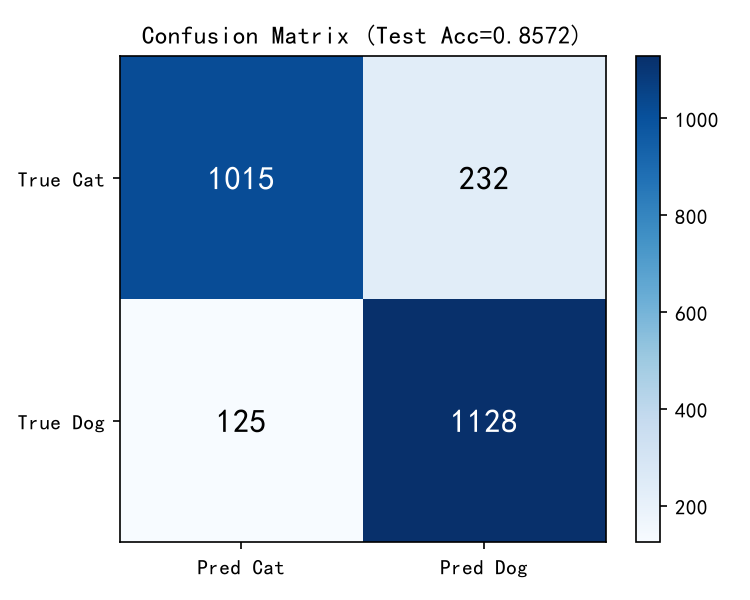


**指标分析：**

- 猫：Precision 1015/(1015+125)=89.04%，Recall 1015/(1015+232)=81.40%
  狗：Precision 1128/(1128+232)=82.94%，Recall 1128/(1128+125)=90.02%
  共 357/2500 错误
- **模型存在明显的"倾向于狗"偏差**：预测为狗的有 1360 张（54.4%），而真实狗占比只有 50.1%
  猫被误判成狗的 232/1247=18.6%，而把狗误判成猫的只有 125/1253=10.0%，两类召回率相差 8.6pp，说明模型在"拿不准"时更倾向输出狗
  *看下面的错误样本图像也看得出来*
- **Train Acc 为何略低于 Val Acc**（epoch 10：0.8561 vs 0.8588）：这种微小的差异不是拟合问题
  Train Acc 是在对**数据增强后**图片统计的（翻转/裁剪/颜色扰动使任务拟合本身更难），而 Val Acc 是在原图上统计的，所以该现象印证了**数据增强的正则化作用**
  真正的拟合有误信号要看 train-loss
- **Val 0.8636 → Test 0.8572 的 0.064 差距**
  主要两个来源：
    - **最佳模型选择偏差**：从 10 个 epoch 里挑 val 最高的 epoch 9，val 估计本身带正偏差（挑的就是最优解）
    - 2500 张样本的二项标准误约 0.7pp，单次划分本身有波动，因此测试集才是最终可信的泛化估计，0.8572 与 0.8636 的差异在合理范围内，是正常的
- **训练曲线形态**：Loss 从 0.6477 单调降到 0.3178，Train Acc 稳定上升，说明网络确实学到了特征
  但 Val Acc 在 0.82-0.86 区间震荡，没有稳定平台期，说明 64×64 输入的信息量有限，10 epoch 内尚未训练稳定，可以大胆推测如果继续训练 + 学习率衰减能再提升一些

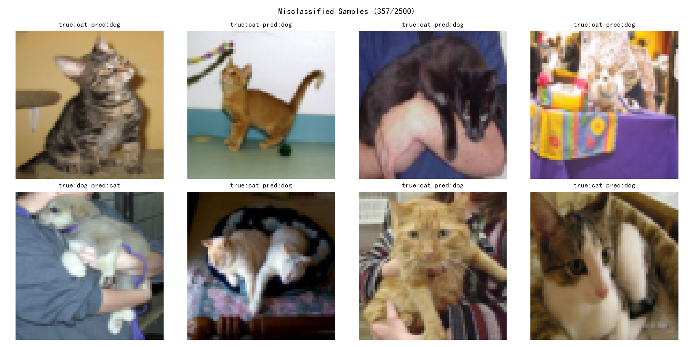

结合混淆矩阵和图中真实错误样本，错误集中在：
- 主体占画面比例小、背景占主导
- 身体被遮挡或姿态刁钻（只露头、身体蜷缩）
- 猫狗外形相近的个体（小型犬 vs 猫，本身 Resize 到 64×64 下猫狗脸部细节已经模糊了）
- 图片模糊或光线差
**这些正是信息在 Resize 到 64×64 时损失比较大的样本，与倾向于狗的偏差叠加导致猫的召回率较低**

**可验证的改进方向**：更大输入尺寸（64→128/224，可以减少细节损失）、改用 ResNet-18网络 + 残差连接（已在扩展实验中实现）、增加 epoch 并在平台期衰减学习率、用 RandomResizedCrop 增强尺度鲁棒性等等

### 8. 保存最佳模型 + 独立推理程序

验证集准确率最高的权重保存到 `weights/best.pth`
再利用`infer.py` 独立完成与测试时一致的数据预处理，并输出类别和概率：

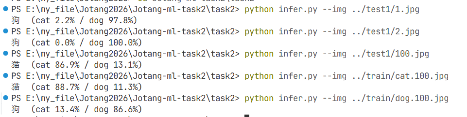
*经我人工查看，这都是对的，证明模型推理能力还行*

### 9. 模型结构图

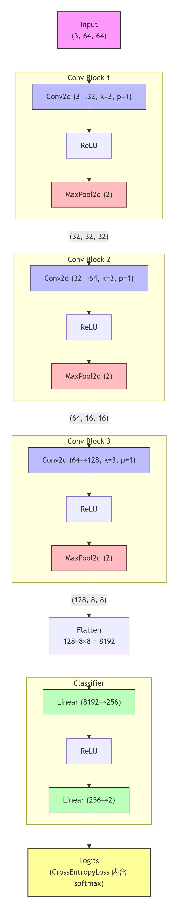

### 10. 文件说明

- `conv2d.py`：手搓 2D 卷积 + 四种卷积核 + valid/same 对比
- `loader_data.py`：数据读取与预处理（变换 + 8:1:1 划分），可直接运行查看 batch 组成与预处理前后对比图
- `cnn.py`：CNN、训练、保存最佳模型、基础可视化（数据部分从 `loader_data.py` 导入）
- `evaluate.py`：加载模型跑测试集，生成混淆矩阵/错误样本/首末层特征图/数据集样本图
- `infer.py`：输入单图独立推理
- `aug_compare.py`：无增强对照训练
- `extra_exp.py`：首末层的 L2 范数、BasicBlock/Bottleneck 对比
- `resnet.py`：手写 ResNet，block 可在 BasicBlock/Bottleneck 间替换

---

## 趁热打铁

### 1. 卷积为什么比全连接更适合图片

- **参数共享 + 局部连接**：一个固定 3×3 核在整张图上滑动并复用，只有 9 个权重；而全连接层每个输入像素都连到每个输出神经元，参数与输入尺寸成正比
- **参数量少得多**：3 个卷积层参数共 93,248（conv1 仅 (3xx3x3+1)x32=896）；而 2 个全连接层共 2,097,922，占全部 2,191,170 参数的 **95.7%**——而且这还是经过 3 次池化、把展平维度压到 8192 之后的结果，若第一层直接全连接 64×64×3=12,288 个输入到 256 个神经元，仅这一层就需 12,288×256 ≈ 314 万参数
- **保留二维空间结构**：卷积输出仍是二维特征图，边缘/纹理的位置关系被保留；而全连接会把图像拉成一维向量，邻域结构彻底丢失，也无法通过池化获得平移不变性，失去先验空间信息

### 2. 输入/输出通道与卷积核数量

- **输入通道 = 上一层特征图通道数**，因为每个卷积核对**所有输入通道**做加权求和后产生 **1 个**输出通道在中心像素位置，所以**输出通道数 = 卷积核个数**
- 我的模型：conv1 有 32 个核（输入 3 通道 → 输出 32），conv2 有 64 个核（32→64），conv3 有 128 个核（64→128）
- **参数量公式**（k=3，含偏置）：`C_in × C_out × k × k + C_out`，如 conv3 = 64×128×9+128 = 73,856

### 3. padding/stride/pooling 尺寸计算

$H_out=⌊(H_in−K+2P)/S⌋+1$
*卷积和池化的通用公式*

- conv1卷积：
   输入 64×64，k=3，p=1，s=1，输出 = (64 + 2×1 − 3)/1 + 1 = **64×64**（与 conv1 shape 一致，所以是same padding）
- pool1池化层：
   输入 64×64，k=2，s=2，p=0，输出 = (64−2)/2+1 = **32×32**（与 pool1 shape 一致）
- 后续同样可推：32→conv(同尺寸)→pool→16→conv→pool→8（与我们模型的 (128,8,8) 完全一致）

### 4. 宽高变小、通道变多的原因
主要原因在于从**空间信息**向**语义信息**的转换：**空间换语义**
- 宽高变小（空间维度降低）：
    - 扩大感受野：随着网络加深，通过池化（Pooling）或步长大于1的卷积（Stride > 1），特征图的尺寸逐渐减小
      这使深层神经元能看到输入图像中更大的区域，从而捕捉全局的、抽象的语义特征（如整个人脸、整个车）
    - 减少计算量：空间尺寸的减小大幅降低了特征图的内存占用和后续层的计算量，防止计算资源爆炸
    - 平移不变性：这种降采样使得网络对图像中物体的微小位移不那么敏感，增强了模型的鲁棒性

- 通道数变多（深度增加）：
  - 提取丰富的特征：浅层网络通常提取边缘、颜色、纹理等低级特征
    深层网络需要提取更复杂、更多样的高级特征（如不同物体的部件、不同角度的特征等），增加通道数相当于增加了网络的“宽度”或“容量”，让网络能够同时学习多种不同的特征表示

### 5. 激活函数和损失函数的选择

**激活函数：隐藏层用 ReLU，输出层不加激活（配合 CrossEntropyLoss）** 
- 隐藏层选 ReLU 的原因： 
  - 二分类需要有非线性的·变换来拟合复杂的决策边界，ReLU 就可以提供非线性 
  - 正区间梯度恒为 1，不像 Sigmoid/Tanh 两端梯度趋近 0，深层网络不易梯度消失，更稳定 
  - 计算只需一次 max(0, x)，比 Sigmoid/Tanh 的指数运算快得多 
- 输出层不加 Sigmoid/Softmax 的原因：
  - 使用 CrossEntropyLoss 时内部已集成 log _softmax，手动再加会导致双重变换，梯度变小、训练变慢
**损失函数：CrossEntropyLoss（输出层 2 个神经元）**
- 为什么适合二分类：
  - 内部 = log_ softmax + NLLLoss，把网络输出的"分数"变成归一化的对数概率 
  - 惩罚是指数级的：真实类别的预测概率越低，loss 越大，梯度信号越强，收敛越快，符合二分类的损失函数要求 
  - 相比 MSE：MSE 配 Sigmoid 输出时，预测错误的梯度极小（梯度消失），收敛很慢，但交叉熵就没有这个问题 
**如果是 K 分类怎么办** ：损失函数不变（CrossEntropyLoss 通吃），只需输出层改成 K 个神经元，标签用 0~K-1 的整数

### 6. 数据增强为什么只用于训练集

- 训练集增强的目的是**人为扩充数据多样性**，给模型制造没见过的图片版本，是一种正则化手段；我们做了实验实测发现有增强模型 epoch 4 后验证准确率反超无增强模型
- 验证/测试集的目的是**无偏估计模型真实性能**，必须只用真实图片来验证其在真实场景下的表现
  而且呢，增强变换还有破坏标签的风险（如裁剪把猫裁没、垂直翻转出现不存在的狗形态等等），评估时引入这类样本会让指标本身失真

---

## 拓展

### 1. AlexNet / VGG / ResNet 对比

| 模型 | 权重层数 | 卷积核特点 | 参数量 | 核心创新 |
|---|---|---|---|---|
| AlexNet | 8（5 conv+3 fc） | 11×11、5×5、3×3 | ~61M | 首个深度 CNN，ReLU、Dropout、双 GPU |
| VGG16 | 16 | 全部 3×3 小核堆叠 | ~138M | 用两层 3×3 替代 5×5，结构统一易堆叠 |
| ResNet-18 | 18 | 3×3 + 残差连接 | **11,177,538（本实验实测）** | 残差连接，让网络学残差 |
| ResNet-50 | 50 | 3×3 夹在 1×1 之间 | **23,512,130（本实验实测）** | Bottleneck 降维，支持上百层计算 |

- AlexNet 证明"深+大数据+GPU"可行但参数巨大，引入 ReLU、Dropout、双 GPU 等创新
- VGG 发现小核堆叠既省参数又增加非线性，结构统一易堆叠
- ResNet 引入残差连接，用跳跃连接解决深层梯度退化，使参数量/深度的性价比大幅提升

### 2. 第一层 vs 最后一层特征图 L2 范数


用保存的模型对真实猫图取特征，对 `b×c×h×w` 沿 h、w 两维求 L2 范数得 `b×c`：

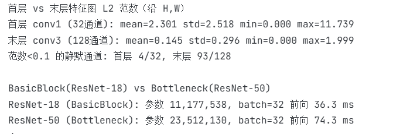

- 首层几乎所有通道都被激活，范数大（像素级边缘/纹理信号密集），对应输入图像的边缘、颜色、纹理等低级特征
- 末层响应稀疏，72.7% 的通道范数接近 0，只有少数通道强烈激活，对应与当前图片相关的高级语义（如猫脸、耳朵），而大量与输入无关的狗特征通道保持静默
- 特征从"稠密的底层信号"变成"稀疏的语义选择"，这正是深层网络的工作方式

### 3. BasicBlock vs Bottleneck


`resnet.py` 中 block 可直接替换，在 batch=32、224×224 输入：

| 结构 | 参数量 | 前向耗时(batch=32) |
|---|---|---|
| BasicBlock ×8（ResNet-18） | 11,177,538 | 36.3 ms |
| Bottleneck ×16（ResNet-50） | 23,512,130 | 74.3 ms |

- BasicBlock：2 个 3×3 卷积，残差通道不扩维，参数量大，只适合浅层网络ResNet-18/34 使用
- Bottleneck：1×1 降维 → 3×3 → 1×1 升维（expansion=4），用 1×1 卷积压缩通道，然后就可以把昂贵的 3×3 卷积限制在低维空间，因此**参数量/深度翻倍时 3×3 卷积计算量得到控制**，是 ResNet-50/101/152 能堆到上百层的关键
- 但在本任务数据规模小、二分类的场景下，ResNet-18 性价比更高

### 4. 手写经典网络

见 `resnet.py`，实现Resnet-18/Resnet-50（只需要更改 block 即可）

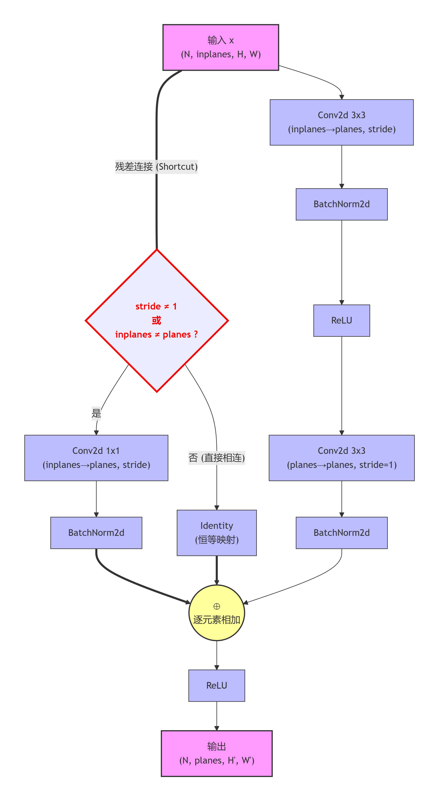
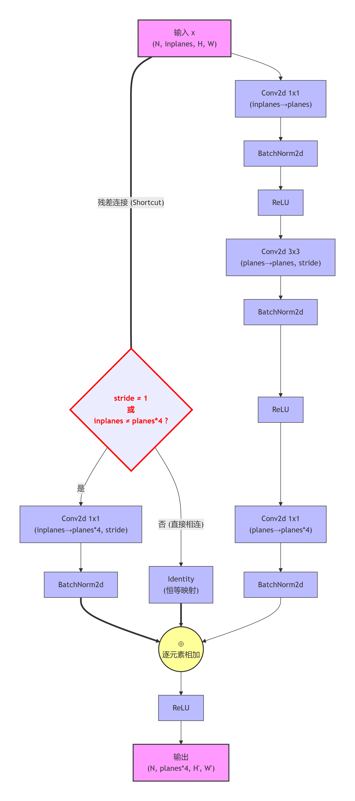
