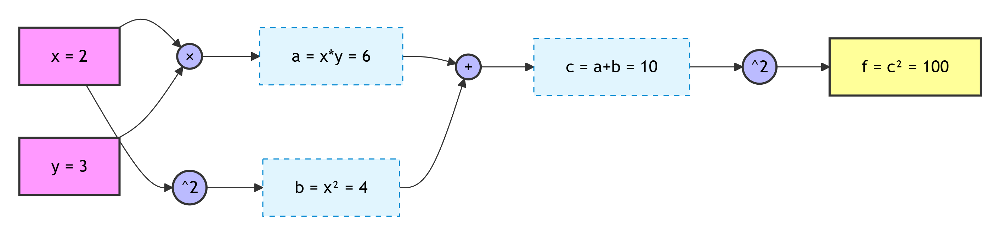
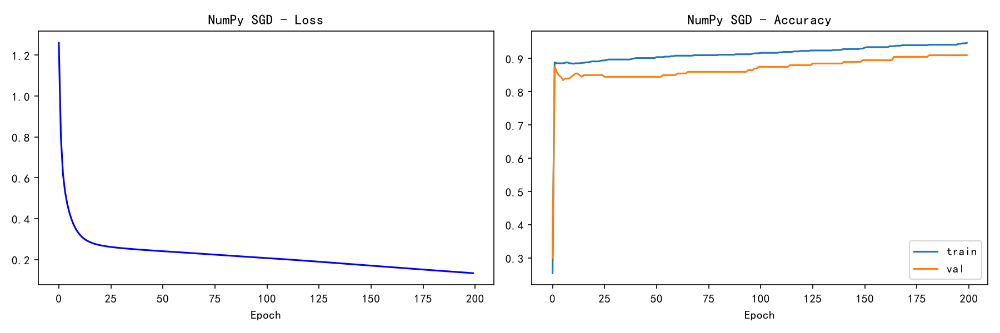
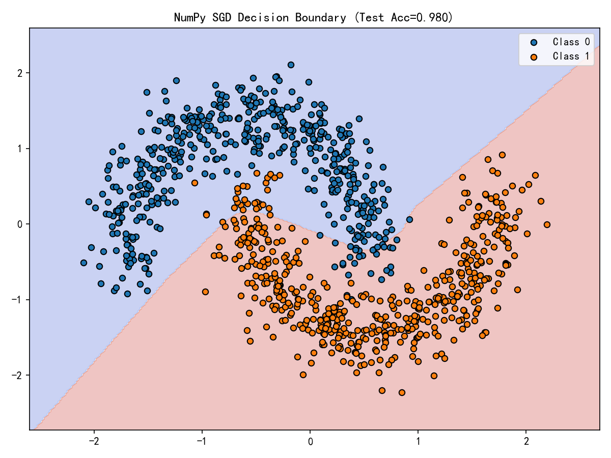

# Task 3：手动反向传播

在 Task 1/2 里我们只调一行 `loss.backward()`，PyTorch 就把所有反向梯度算好了，那具体是怎么计算的呢？

---

## 实践 1：简单计算链

对函数 `f(x, y) = (x*y + x**2)**2`，取 `x=2, y=3`。

### 计算图拆解



```
a = x*y = 6
b = x^2 = 4
c = a+b = 10
f = c^2 = 100
```

### 链式法则（从后往前）

```
df/df = 1
df/dc = 2c = 20                     (f = c^2)
df/da = 2c * 1 = 20                 (c = a+b)
df/db = 2c * 1 = 20
df/dx = df/da*y + df/db*2x = 20*3 + 20*4 = 140
df/dy = df/da*x = 20*2 = 40
```

### 运行结果（practice1_chain.py）

```
前向: a=6  b=4  c=10  f=100
NumPy 手动反向:  df/dx=140  df/dy=40
解析解:          df/dx=140  df/dy=40
PyTorch autograd: df/dx=140  df/dy=40
最大绝对误差 = 0.00e+00  -> 结果一致!
```

三种方式（手动链式 / 解析解 / autograd）完全一致。

---

## 实践 2：神经网络的梯度

网络结构：`X → Linear(W1,b1) → ReLU → Linear(W2,b2) → Sigmoid → BCE Loss`

### 形状标注（隐藏层 H=4，输入维 D=2）

| 符号 | 单样本 | 小 batch(N) | 含义 |
|---|---|---|---|
| X | (2,) | (N,2) | 输入 |
| W1 | (4,2) | (4,2) | 第一层权重 |
| b1 | (4,) | (4,) | 第一层偏置 |
| z1=X@W1.T+b1 | (4,) | (N,4) | 线性输出 |
| h=relu(z1) | (4,) | (N,4) | 激活 |
| W2 | (1,4) | (1,4) | 第二层权重 |
| b2 | (1,) | (1,) | 第二层偏置 |
| z2=h@W2.T+b2 | (1,) | (N,1) | logit |
| p=sigmoid(z2) | (1,) | (N,1) | 概率 |
| loss | 标量 | 标量(mean) | BCE |

### 反向传播公式（关键）

```
dz2 = (p - y) / N            # BCE+Sigmoid 组合梯度（最核心简化）
dW2 = dz2.T @ h
db2 = sum(dz2)
dh  = dz2 @ W2
dz1 = dh * (z1 > 0)          # ReLU 掩码
dW1 = dz1.T @ X
db1 = sum(dz1)
```

### 运行结果（practice2_nn.py）

**单个样本 (N=1)**：loss=0.66148416
```
W1 (4,2)  误差 0.00e+00 ✓
b1 (4,)   误差 0.00e+00 ✓
W2 (1,4)  误差 0.00e+00 ✓
b2 (1,)   误差 0.00e+00 ✓
-> 梯度一致!
```

**小 batch (N=8)**：loss=0.62876111
```
W1 (4,2)  误差 1.39e-17 ✓
b1 (4,)   误差 2.78e-17 ✓
W2 (1,4)  误差 1.39e-17 ✓
b2 (1,)   误差 0.00e+00 ✓
最大绝对误差 = 2.78e-17 -> 梯度一致!
```

batch 时误差 ~1e-17 是浮点累加顺序差异，属正常。公式本身完全不变，只是 X/h/z1 等中间量从 `(H,)` 变成 `(N,H)`，多了一维 batch。

---

## 趁热打铁

### 1. 前向传播时为什么要保存每一层的输入/输出？反向传播在哪里用到？和显存有什么关系？

反向传播的链式法则需要用到**前向时的中间值**。比如：
- 算 `dz1 = dh * (z1>0)` 需要前向的 `z1`（判断 ReLU 哪些位置激活）
- 算 `dW2 = dz2.T @ h` 需要前向的 `h`
- 算 `dW1 = dz1.T @ X` 需要前向的输入 `X`

如果前向不保存这些中间结果，反向就没法算。这就是为什么 PyTorch 默认会**为计算图缓存激活值**。

**和显存的关系**：网络越深、batch 越大，缓存的中间激活越多，显存占用越高。这也是为什么大模型训练显存吃紧——不只是参数占显存，反向要用的激活值往往占得更多。（对应技巧：gradient checkpointing，用重算换显存。）

### 2. 链式法则怎样把损失的梯度传回第一层权重？

沿着计算图**逐节点相乘**。以本题的 W1 为例：

```
dL/dW1 = dL/dz2 · dz2/dh · dh/dz1 · dz1/dW1
        = [(p-y)/N] · [W2] · [relu'(z1)] · [X]
```

每一步都是"上游梯度 × 本地导数"。从 loss 出发，每经过一个节点就把链乘一项，一直传到最前面的 W1。只要每个节点会算自己的本地导数，整条链就能自动接上——这就是反向传播的本质。

### 3. BCE 与 Sigmoid 配合后，loss 对 logit 的梯度是什么？为什么方便？

推导：
```
p = sigmoid(z2) = 1/(1+e^-z2)
L = -[y·log p + (1-y)·log(1-p)]

dL/dz2 = dL/dp · dp/dz2
dL/dp = -y/p + (1-y)/(1-p) = (p - y)/(p(1-p))
dp/dz2 = p(1-p)
=> dL/dz2 = (p-y)/(p(1-p)) · p(1-p) = p - y
```

**结果：dL/dz2 = p − y**（batch 时再除以 N）。

方便之处：
- Sigmoid 的导数 `p(1-p)` 和 BCE 的分母 `p(1-p)` **正好约掉**，形式极简
- 不会出现 `p→0/1` 时梯度消失的数值问题
- 代码里一行 `dz2 = (p - y)/N` 就搞定，不用分别算两个导数再相乘

这就是为什么"Sigmoid + 交叉熵"是绝配（Softmax + 交叉熵同理，梯度也是 `p - y`）。

### 4. NumPy 梯度与 PyTorch 出现差异时，怎么判断问题出在哪？

按排查顺序：

1. **损失的求平均方式**：最容易踩。PyTorch 的 `binary_cross_entropy` 默认 mean，NumPy 手算如果忘了 `/N`，梯度会差 N 倍。先看量级差多少——差整数倍基本就是这里。
2. **矩阵转置**：`W1` 我存的是 `(H, D)`，前向是 `X @ W1.T`，反向 `dW1 = dz1.T @ X`。如果某处忘了 `.T`，形状会对不上或数值错。打印每个量的 shape 对照。
3. **广播**：`db1` 要对 batch 维 `sum(axis=0)`，如果直接 `dz1`（没求和）就是形状 `(N,H)` 而不是 `(H,)`。
4. **公式本身**：逐项打印中间梯度（dz2、dh、dz1），定位是从哪一步开始偏的。

经验：**先看量级（差几倍→求平均），再看形状（转置/广播），最后看数值（公式）。**

### 5. 完成两次验证后，怎么理解 `loss.backward()`？它替我们做了什么？

`loss.backward()` 其实就是一个**自动反向传播引擎**，它替我们做了：

1. **建计算图**：前向时记录了每个 op（matmul、add、relu、sigmoid...）及其依赖关系
2. **缓存中间值**：保存反向要用的各层输入/输出（对应第 1 问）
3. **查导数表**：每个 op 都有预定义的本地导数（比如 matmul 的导数是交换相乘）
4. **拓扑排序 + 链式相乘**：从 loss 出发，按逆拓扑序逐节点"上游梯度 × 本地导数"，把梯度累加到每个 `requires_grad=True` 参数的 `.grad` 上

我们手写的 `dz2→dh→dz1→dW1` 这一串，PyTorch 在内部用同样的链式法则自动展开。所以本题 NumPy 手算和 autograd 完全对得上——**autograd 没有魔法，就是把我们手算的链式法则自动化了。**

### 6. 遇到的报错 / 不理解的点

- 一开始 batch 版本的 `dW1 = dz1.T @ X` 形状对不上，后来发现是 X 忘了 `np.atleast_2d`，单样本时 X 是 `(2,)` 导致 `(4,1)@(2,)` 出错。统一成二维后正常。
- 对"loss 要不要除以 N"犹豫过——确认 PyTorch 默认 mean 后，NumPy 这边 `dz2 = (p-y)/N` 才和它对上。

---

## 拓展：NumPy SGD 训练完整 make_moons

用上面手写的反向传播 + 最朴素的 SGD（lr=0.5, 200 epoch, 隐藏层 16）训练完整训练集。

### 运行结果（extension_train.py）

```
train=700 val=200 test=100
Epoch  40/200 | loss=0.2482 | train=0.9000 | val=0.8450
Epoch  80/200 | loss=0.2210 | train=0.9100 | val=0.8600
Epoch 120/200 | loss=0.1937 | train=0.9229 | val=0.8800
Epoch 160/200 | loss=0.1631 | train=0.9343 | val=0.8950
Epoch 200/200 | loss=0.1332 | train=0.9471 | val=0.9100

NumPy SGD Test Acc = 0.9800
(对比: Task1 PyTorch MLP Test Acc ≈ 0.98)
```




### 与 Task1 PyTorch 模型对比

| | NumPy 手写 SGD | Task1 PyTorch(Adam) |
|---|---|---|
| Test Acc | 0.98 | 0.98 |
| 优化器 | 朴素 SGD | Adam |
| 收敛速度 | 慢（200 epoch 还在爬） | 快（几十 epoch 收敛） |
| 反向传播 | 手写链式 | autograd |

两者最终精度相当（都 ~0.98），验证了手写的反向传播是正确的。差别在收敛速度：朴素 SGD 没有动量和自适应学习率，loss 从 0.25 慢慢爬到 0.13，远不如 Adam 干脆。这正对应 Task1 优化器实验的结论——Adam 收敛远快于 SGD。
