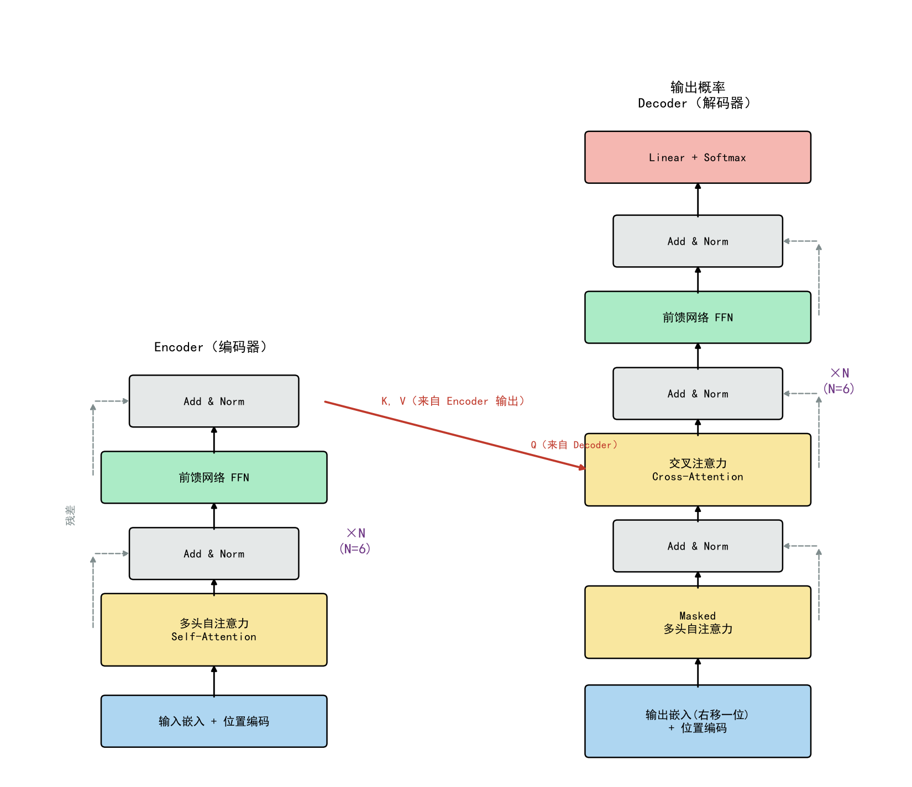
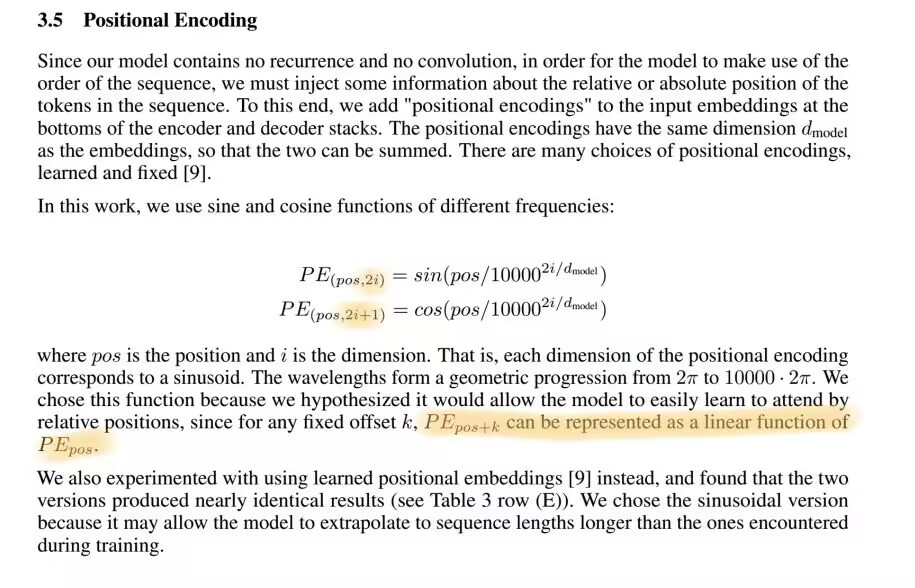
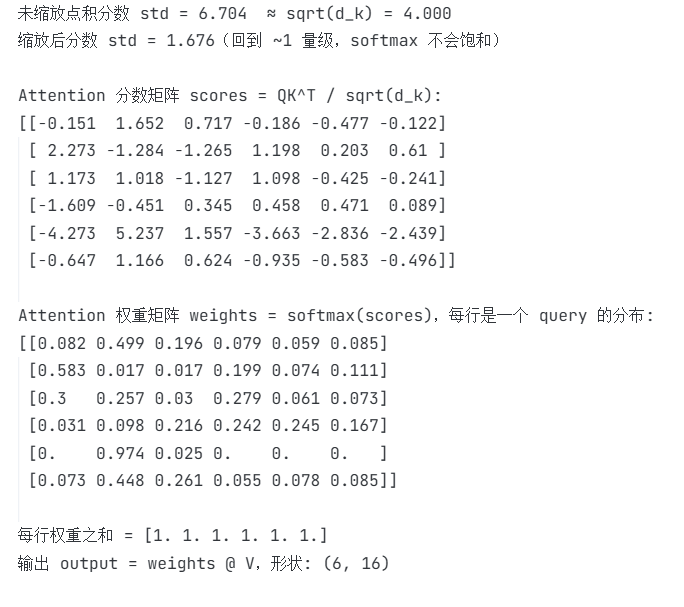
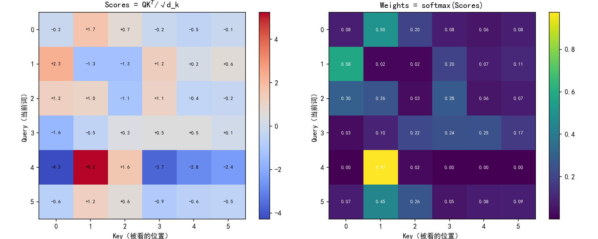
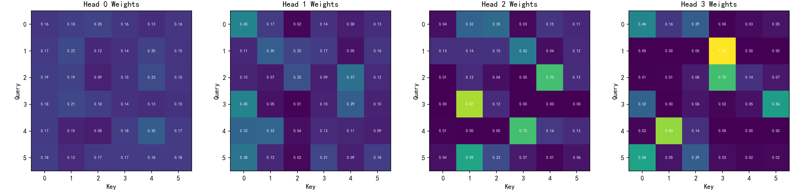
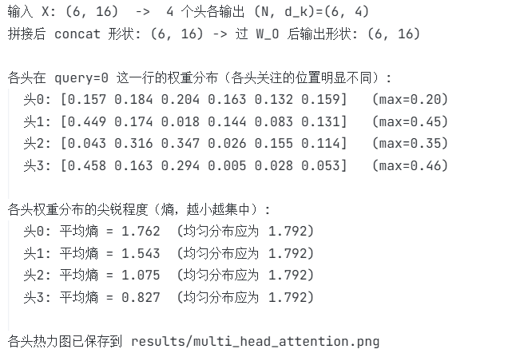

# Task 4：Transformer 阅读笔记（Attention Is All You Need）

## 阅读顺序和资料工具

按建议的顺序读的：

1. **标题/摘要/引言** → 知道这篇论文要解决机器翻译里 RNN 串行慢的问题
2. **Figure 1** → 先把整体结构看懂（左 Encoder 右 Decoder），不看细节
3. **精读第 3 节** → Scaled Dot-Product Attention、Multi-Head、FFN、位置编码逐个过
4. **实验和结论** → WMT14 翻译 BLEU 刷到 SOTA，训练比以前快得多

用的资料/工具：

- 论文原文（arXiv: 1706.03762）
- Jay Alammar 的《The Illustrated Transformer》对照着看（图比论文 Figure 2 好懂很多）
- 自己写代码验证（拓展 1/2）：很多公式看着懂了，写一遍才知道是真懂还是没懂

### 读不懂的地方 → 后来怎么理解

| 一开始读不懂的 | 后来怎么理解的 |
|---|---|
| Q/K/V 为什么一个向量要变成三个 | 用**检索系统**类比：Q=搜索词，K=网页关键词索引，V=网页实际内容，搜索词和索引算相关度，再用相关度加权取内容（如果只用一个X当作Q/K/V，） |
| 为什么除以 √d_k | 论文说 q·k 的方差是 d_k，点积太大 softmax 会饱和、梯度消失，**我们写代码验证**：16 维下未缩放分数 std=6.7（√16=4 同量级），除完后 std=1.7，确实回到 1 量级 |
| Multi-Head 把 512 拆成 8×64 是不是使用的参数变多了 | 不是，总参数量不变，只是把注意力**拆到 8 个低维子空间里各做各的** |
| Masked Attention 的 mask 到底怎么实现 | 就是把分数矩阵的**上三角位置置成 -∞**，softmax 之后这些位置权重变成 0，就可以做到"看不到未来"了 |

### 目前我存在的Questions

1. 正弦位置编码到底好在哪？论文说为了外推到训练时没见过的序列长度，但实验部分好像并没有真的验证这一点，而且后来 BERT 用可学习的位置编码效果也差不多吧（？）
2. 注意力权重的"可解释性"到底有多可信？各头真的学到语法/语义分工吗，因为我看到后续有研究发现很多头去掉也不影响效果，所以这个各头到底是学习到了不同的信息还是只是随机分配或者都学到全局信息只不过各头彼此间有正则化效果？
3. FFN 为什么是先升维 4 倍（512→2048）再降回来？论文完全没解释4这个魔法数字，一拍脑袋想到的吗？还是实验体现的呢？

---

## Figure 1：Encoder 和 Decoder

Figure 1 左半是 **Encoder**（编码器），右半是 **Decoder**（解码器）
参考原图自己重画了一张简化（中文版）：



- **Encoder**（左）：输入嵌入+位置编码 → 【多头自注意力 → Add & Norm → FFN → Add & Norm】× 6
- **Decoder**（右）：输出嵌入（右移一位）+位置编码 → 【Masked 自注意力 → Add & Norm → 交叉注意力 → Add & Norm → FFN → Add & Norm】× 6 → Linear + Softmax
- **简化**：把原图每个子层的"残差+LayerNorm"合并画成一个小灰块儿 Add & Norm
- **拓展标注**：红色箭头标出交叉注意力里 K、V 来自 Encoder 输出、Q 来自 Decoder，以及标明两列各重复 N=6 次

---

## 阅读问答

### 1. 这篇论文最初处理的是什么任务？为什么尝试不用 RNN 和 CNN？

**任务**：机器翻译（WMT14 英→德、英→法）

**为什么不用 RNN**：
- RNN 的计算是 `h_t 依赖 h_{t-1}`，**天生串行性质**，序列一长完全没法并行，GPU 核心再多也用不上
- 长距离依赖要一步步传，路径长度 O(n)，隔 100 个词的信息传着传着就淡了甚至没了

**为什么不用 CNN**：
- CNN 可以并行，但感受野是局部的，相距 k 的两个位置要堆 log_k(n) 层才能建立联系
- 论文也承认 CNN 的优点（多通道输出），所以用了位置编码 + 多头注意力来弥补CNN具有的先验优势

Self-Attention 把任意两个位置之间的路径缩短到 **O(1)**，而且整个序列可以**一层内并行**算完，这两个问题就一起解决了

### 2. Self-Attention 中的 "Self" 是什么意思？它和普通 Attention 有什么区别？

- **"Self"（自）指 Q、K、V 都来自同一个序列**：序列自己算自己内部的注意力，每个词在同一个句子内找和谁相关

- **和普通 Attention 的区别**：经典的 attention（如 Bahdanau，用在 Seq2Seq 翻译里）是**两个不同序列之间**算的：Q来自Decoder的当前时刻，K/V来自Encoder的输出，而Self-Attention 把这个"一方查询另一方"变成了"自己查自己"
- 实则原论文结构里其实**两种都保留**了：Encoder 内部和 Decoder 内部是 Self-Attention，Encoder→Decoder 那层叫 Cross-Attention（我们自己画的结构图里添上的中间那条红箭头）

### 3. Q、K、V 分别来自哪里？它们为什么要经过不同的线性变换？

- **来源**：Encoder 的 Self-Attention 里，Q、K、V 都来自**同一个输入 X**，分别乘三个不同的权重矩阵得到：

```
Q = X·W_Q    K = X·W_K    V = X·W_V
```

- Decoder 的 Cross-Attention 例外：Q 来自 Decoder，K/V 来自 Encoder 输出

- **为什么用不同变换**：一个词在注意力里扮演三种角色

| 角色 | 含义 | 类比检索系统 |
|---|---|---|
| Q | 我想找什么信息 | 搜索词 |
| K | 我有什么特征可以被别人匹配到 | 网页关键词 |
| V | 匹配上之后我实际提供的内容 | 网页正文 |

这三种角色需要的表示本来就不一样
如果共用一个矩阵，"被匹配的特征"和"提供的内容"就被绑死了，而且词会倾向于只和"和自己最像"的词加权，表达力就大打折扣

### 4. Attention 的结果为什么要经过 softmax？得到的每一行权重表示什么？

- **为什么要 softmax**：点积分数有正有负、没有上限，不能直接当"权重"用，softmax 把每一行分数变成**非负、和为 1** 的分布，才能拿来做加权平均，而且指数还会放大分数差距，让模型"聚焦"到最相关的几个位置上

- **每一行权重表示什么**：`weights[i]` 是**第 i 个词（query）对所有位置（key）的关注程度分配**——相当于"我看这句话时，注意力怎么分给各个词"
每行和恒为 1，所有行合起来就是一张"谁该看谁、看多少"的关系图（拓展 1 的热力图里能直观看到注意力是如何分布的）

### 5. Multi-Head Attention 为什么要分成多个头？多个头只是把同一件事重复多次吗？

- **不是重复，是分工**，单头只有一组权重分布，多种关系（语法、指代、相邻、长距离…）会互相干扰、被平均掉很多信息，多头把 512 维拆成 8 个 64 维子空间，每个头在自己的子空间里学一种关系模式（论文里是这么说的，但真的是只学一种吗？？？）
- **验证**：我们写代码验证了"各头关注模式确实不同"**（拓展 2）：给不同头不同的 Q/K 缩放，4 个头在同一行的注意力分布从接近均匀（熵 1.76）到高度集中（熵 0.83），各头关注的位置明显不同：这就对应了"有的头看局部、有的头看全局"的说法

- **另外**：另外总计算量和单头 512 维基本一样（8×64=512），所以多头是**免费的多样性**，不多占用显存但能增加模型的表达力（爽了）

### 6. Transformer 没有循环结构，它怎样知道词语的先后顺序？

- **注意力**：注意力本身是**置换不变**的，把输入顺序打乱，输出只是同样打乱但数值不变，但模型根本不知道谁前谁后，所以必须**显式把位置信息加进去**：

```
输入 = 词嵌入 + 位置编码
```


- 论文用不同频率的 sin/cos 生成每个位置的固定编码（偶数维 sin，奇数维 cos），不同位置得到独一无二的"指纹"；而且由三角恒等式，`PE(pos+k)` 可以表示成 `PE(pos)` 的线性变换，方便模型学习相对位置关系

### 7. Decoder 中为什么需要 Masked Attention？如果能提前看到后面的答案会发生什么？

- Decoder 训练时用 **teacher forcing**：整个目标序列一次性并行输入，每个位置都要预测下一个词
- 如果不加 mask，预测第 i 个词时注意力能直接看到第 i+1 位之后的词——**相当于考试时抄答案**，都可以看见了还预测什么？？

- 后果：训练 loss 极低（模型学会了"直接复制后面的词"），但**推理时根本没有未来信息**（是一个词一个词生成的），训练和推理不一致，推理是完全失败的

- 实现上就是把**分数矩阵上三角置 -∞**，softmax 后未来位置的权重=0（"看不见"这些信息）

### 8. 残差连接、Layer Normalization 和 Feed-Forward Network 分别出现在结构图的哪里？它们大致有什么作用？

| 组件 | 位置（见上面结构图） | 作用 |
|---|---|---|
| 残差连接（虚线） | 每个子层旁边绕过去的灰虚线：`x + Sublayer(x)` | 给梯度开一条直通高速路，网络堆到 6 层×2 列也能训练，缓解深层网络退化的问题 |
| Layer Norm（Add & Norm 灰块儿） | 每个子层之后各一次 | 把每层输出的分布拉回固定稳定范围，训练更稳、收敛更快 |
| FFN（绿色块儿） | 每层注意力之后，Encoder/Decoder 各一层 | 逐位置独立的两层线性（512→2048→512，ReLU），对注意力聚合完的信息做非线性加工，相当于"消化"注意力收集来的信息 |

原论文是 Post-LN（先残差相加再归一化），后来的 GPT 等改成了 Pre-LN，训练更稳定：残差连接在归一化之前，所以残差的梯度不会经过LN

---

## 拓展

### 拓展 1：手写单头 Scaled Dot-Product Attention

纯Numpy手写：


```
scores = QK^T / sqrt(d_k)   ->   weights = softmax(scores)   ->   output = weights @ V
```

随机输入 (N=6, d_model=16)，打印分数矩阵和权重矩阵，并画成热力图：





**验证了 sqrt(d_k) 的理论**：未缩放分数 std=6.70（√16=4 同量级，证明"点积方差≈d_k"的说法是对的），除以 √d_k 后 std=1.68，回到 1 量级，softmax 不会饱和

从权重热力图能直观看到 softmax 的"聚焦"：第 5 行 97.4% 的权重集中在一个位置，其余行则相对平缓，每行就代表"这个词在看谁"

### 拓展 2：拓展为多头注意力

4 个头（每头 d_k=4），每头独立的 W_Q/W_K/W_V，各自做一遍拓展 1 的注意力，拼接后过 W_O 融合：



**验证了"多头不是重复劳动"**：4 个头在同一 query 行的关注位置明显不同，注意力分布的尖锐程度（熵）从 1.76 一路降到 0.83（均匀分布是 1.79），头 0 几乎均匀地看全句，头 3 则高度聚焦个别位置，各头分工确实不一样（但还是会用很多头有很多重叠信息）


*这种看哪个部分的分配是随机的么？是所有情况下更尖锐的头都会选择全局？这个可以调控全局和局部，但局部具体关注哪里如何控制呢？（我们这里是分配了个系数s，真正的是怎么样实现的呢？）*

### 拓展 3：Transformer 用于图像 —— ViT

选了 **ViT**（An Image is Worth 16x16 Words，Google，2020）：

- **输入是什么**：把图像切成 16×16 的小块（patch），每个 patch 拉平后过一个线性层变成"patch token"（相当于词嵌入），再加上 **[CLS] token** 和可学习的位置编码，凑成一个"patch 序列"喂给模型
- **Attention 在哪发挥作用**：这些 token 过一堆**纯 Encoder**（多头自注意力 + FFN），自注意力让每个 patch 和**所有其他 patch** 直接建立联系，卷积要看很多层才能覆盖的感受野，这里一层就有全局视野，最后取 [CLS] 的输出向量做分类
- **与原论文的不同**：
  1. **只要 Encoder，不要 Decoder**（分类不是序列生成任务，不需要预测下一个token）
  2. 输入是**图像 patch** 而不是词，"词表"来自线性投影而非 embedding 查表
  3. 位置编码是**可学习的**，不是固定 sin/cos 编码，而是用一个线性层学习
  4. 没有 Masked Attention（图像分类 patch 没有因果顺序（其实后面拓展了很多使用了mask））

### 拓展 4：Encoder-only 和 Decoder-only 代表模型

| | **BERT**（Encoder-only） | **GPT**（Decoder-only） |
|---|---|---|
| 结构 | 双向 Multi-Head Self-Attention，**无 mask** | 因果 mask 的单向 Self-Attention |
| 训练目标 | **MLM**：随机遮住 15% 的词让模型猜 + NSP | **下一个词预测**：只根据前文预测下一个 token |
| 适用任务 | 理解类：文本分类、NER、抽取式问答 | 生成类：对话、写作、代码、续写 |
| 代表场景 | 搜索召回、情感分析 | ChatGPT 及一切大模型对话 |

**为什么不同任务选不同结构**：

- **理解类任务**需要看完整上下文：判断情感、消歧代词指代，"未来"的信息同样重要，所以用**双向**的 Encoder，MLM 目标强迫模型综合利用前后文
- **生成类任务**必须单向：逐词生成时未来根本还不存在，Masked Decoder 的训练目标（next token prediction）和推理过程**完全一致**，训练时怎么用实际就是怎么用，而且这种"给前文补全后文"的形式天然统一了翻译、问答、对话各种任务，这也是 GPT 路线最终胜出的原因
- **看懂用 BERT（双向），接着写用 GPT（单向）**，任务的信息流向方向决定了结构
