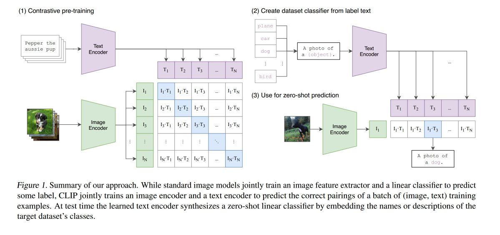
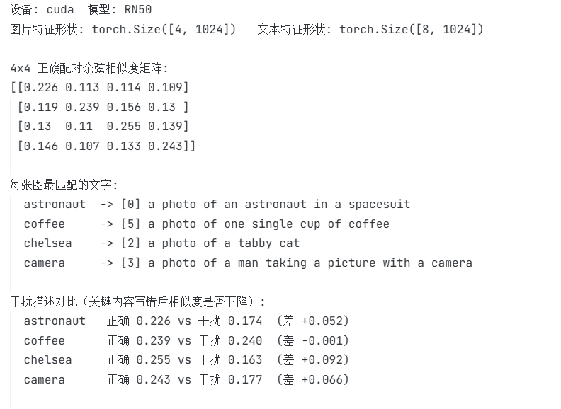
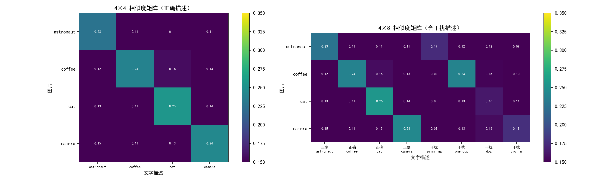
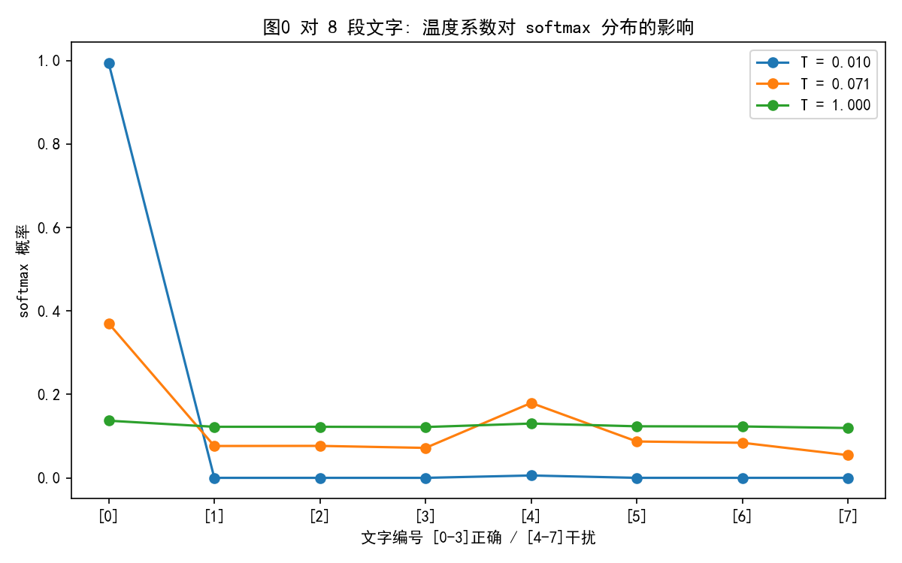

# Task 5：CLIP 阅读笔记（Learning Transferable Visual Models From Natural Language Supervision）

## 阅读顺序和资料

按建议的顺序：摘要 → Figure 1（论文的图真的信息量很大，几乎一眼看懂训练和 zero-shot 流程）→ Introduction → Approach（2.3 选模型、2.4 PK ImageNet 那些小节挑着读）

资料/工具：

- 论文原文（arXiv: 2103.00020）+ OpenAI 官方图文介绍
- OpenAI CLIP 官方代码仓库（拓展实验直接用它加载预训练权重）
- 自己跑推理实验验证（clip_demo.py）：相似度矩阵、干扰描述、温度系数都亲手算了一遍

---

## 任务 1：阅读问答

### 1. 传统图像分类模型需要怎样的数据？CLIP 为什么选择使用互联网上的"图片-文字"对进行训练？

**传统模型需要**：人工标注的固定类别标签数据集
ImageNet 1400 万张图、2.1 万个类别，花了 4.8 万人的几年时间标注，而且每换一个任务就要重新标一版，标注成本线性上涨，太大了

**CLIP 选择图文对的原因**：
- **规模无限**：互联网上天然存在几十亿"图片+alt 文字/标题"的配对，是免费、自动获得的监督信号，不用人手动标注
- **监督信号更丰富**：一个类别名（"cat"）只有 1 个词的信息量，一句自然语言描述有整句话的信息（颜色、动作、场景、关系）
- **泛化是自然结果**：文本的开放组合性让模型见过的"类别"不受数据集类别的限制，这直接带来了后面 zero-shot （零样本）分类的能力（可以把前面学习到的类别进行组合）

### 2. CLIP 由哪两个编码器组成？图片和文字经过编码器以后分别变成了什么？

- **图像编码器**：ResNet-50 或 ViT（论文里两者都训了，取最好的）→ 图片变成一个**图像特征向量**（如 1024 维）
- **文本编码器**：Transformer（GPT-2 风格，63M 参数，8 层 512 宽）→ 句子变成一个**文本特征向量**

两个向量被投影到**同一个多维嵌入空间**，维度相同、都做 L2 归一化，所以可以直接算余弦相似度
这就是"图片和文字说同一种语言"，把图片和文字统一了

### 3. 什么是图文对齐？为什么语义匹配的图片向量和文本向量应该更加接近？

- **图文对齐（image-text alignment）**就是让"描述同一件事的图和字"在嵌入空间里靠在一起：一张猫的图和 "a photo of a cat" 这句话，映射到空间里两个点的余弦相似度应该很高；而它和 "a photo of a dog" 的相似度应该低

- **为什么要接近**：嵌入空间的几何结构就是模型的"知识结构"——**距离近 = 语义相关**
只要这个空间对齐了，"判断图文是否匹配"的复杂任务就退化成算两个向量的余弦相似度的简单任务，零样本分类、检索、聚类全都变成同一套几何操作，不再需要为每个任务单独训模型

### 4. 结合论文 Figure 1，说明一个 batch 中 N 张图片和 N 段文字怎样组成 N×N 个配对？哪些是正样本，哪些是负样本？

一个 batch 取 **N 张图 + N 段文字**，两两算相似度得到 **N×N 矩阵**：

- **对角线上 N 个是真配对（正样本）**：第 i 张图和第 i 段文字确实描述同一内容（同一来源抓取的）
- **对角线外 N²-N 个都是假配对（负样本）**：第 i 张图和第 j (j≠i) 段文字描述的不是同一件事

一个 batch 8 眼睛看到的是：本来 1 张图只需和自己的描述配对，但现在"顺便"和 batch 里其他 N-1 段文字组成了负样本，**一次前向就挖出 N²-N 个监督信号**，这就是这个设计的聪明之处，就这样增加了信息量
论文 Figure 1 左半部分画的紫色矩阵就是这个意思

### 5. CLIP 的训练目标是什么？它怎样让正确配对的相似度升高、错误配对的相似度降低？

- **训练目标：对称的对比学习损失（symmetric cross-entropy / InfoNCE 的双向版）**。

把 N×N 相似度矩阵（乘上可学习的温度系数后）看成两张表：（图片在行，文字在列）
  - 沿**行**做 softmax + 交叉熵：每张图要在 N 段文字里"认出"自己的描述（预测正确文字的索引）
  - 沿**列**再做一遍：每段文字要在 N 张图里"认出"自己的图片
**要文字和图双向对齐**

- 对**两个方向的损失取平均**，梯度上，这等价于同时**拉近正对**（对角线）、**推开负对**（非对角线）
  softmax 分母里有所有错误配对的分数，负对相似度越高，正对被压得越狠、损失越大，模型就被迫把负对分开，这和分类的交叉熵是同一个机制，只不过"类别"从固定的几类类别表变成了"batch 里的其他样本（负样本）"

### 6. 什么是 zero-shot classification？为什么只给出新的类别名称，CLIP 就可以尝试完成分类？

- **zero-shot 分类**：不在目标任务的任何训练样本上训练/微调，可以直接用预训练模型做分类

- **做法**：把类别名套进模板 "a photo of a {label}"，把所有类别句子编码成文本向量
  要分类的图片编码成图像向量，**看它和哪个类别向量余弦相似度最高，就分给谁**（softmax 后就是概率）

- **为什么可行**：因为文本编码器理解的是**自然语言本身**，不是某个固定类别表
  - ImageNet 的 1000 类、CIFAR 的 10 类……任何能写成话的类别它都能现场编码，训练时它已经在 4 亿图文（大规模涵盖所有类别对）上学会了"把图和话对齐"，分类只是"图和哪句话最对齐"的几何问题，ImageNet 上 zero-shot 能到 76.2%，接近原始 ResNet-50 的监督学习水平（效果很不错了）

### 7. 论文中提到的 prompt engineering 是什么？`dog` 与 `a photo of a dog` 可能产生不同结果吗？

- **prompt engineering**：为文本端设计更好的提示模板来提升下游性能，CLIP 论文里的做法包括：
  - 基础模板 "a photo of a {label}"
  - 任务特定模板（OCR 用 "a label of {label}"、卫星图用 "a satellite photo of {label}"）
- **ensemble**：把 80 个模板的文本向量平均（取平均值，再编码），ImageNet 上直接涨了约 3.5%
相当于**统一格式**

- **`dog` vs `a photo of a dog` 会不同吗？of course**
  - 训练时 CLIP 见到的文本是完整的网络句子（图片说明、标题），单蹦一个词 "dog" 和训练分布不匹配；而 "a photo of a dog" 和训练语料（alt 文本风格）很像
  - 论文 Figure 1 的例子就展示了 ImageNet 类别名直接用会掉分、套模板后效果提升，这本质上是让下游输入贴合预训练分布（和今天大模型的 prompt 工程是同一个思想，就是**标准化**的操作）

### 8. CLIP 有哪些限制？互联网图文数据可能带来哪些偏见或错误关联？蕴含什么重要思想？

- **论文自己承认的限制**：
  - zero-shot 在细分类（花、车品牌）上远远不如专家模型（毕竟术业有专攻）
  - 不擅长抽象任务：数数（数 3 个以上物体就不可靠）、细粒度定位（如"在桌子左边有 3 个苹果"）等等
  - 对"对抗性"文本（随机字母组合）几乎瞎猜（因为模型是基于文本编码器的，文本编码器对随机字母组合没有意义）

- **数据偏见**：互联网图文对不是中立的
  - 词频偏见：训练集里 "snow" 常和 "north pole"、白人面孔同时出现，如模型可能把"雪地里的动物"默认成北极熊
  - 人物相关任务上存在性别/种族刻板关联（论文 ImageNet 人像分类实验显示错误分布偏向特定人群）
  - 标注噪声大：alt 文字很多是错的或低质量的（因为来自网上，不保证正确性）

- **重要思想（开放）**：**数据规模 > 数据精标 + 任务特化**
  - 与其花人工造高质量小数据集，不如用海量弱监督数据 + 强大的表征学习，让模型自己提炼知识
  - 这直接预示了后来的**大模型路线**（LLaVA/多模态 GPT-4V 的视觉编码、Stable Diffusion 的文本条件等等）
  - 同时它也敲了警钟：**模型会忠实继承数据里的一切偏见**，数据治理和偏见审计必须跟上前

---

## 任务 2：让 CLIP 配对图片和文字

实验代码 [clip_demo.py](clip_demo.py)，模型采用 RN50（官方预训练权重），只做推理：

1. **图片准备**：4 张内容不同的真实照片，来自 scikit-image 内置样例数据集（来源明确，标注清晰）：

| 图片 | 来源 | 正确描述 |
|---|---|---|
| astronaut | skimage.data.astronaut（NASA 宇航员照片） | a photo of an astronaut in a spacesuit |
| coffee | skimage.data.coffee（咖啡杯样例） | a photo of two cups of coffee on a table |
| chelsea | skimage.data.chelsea（虎斑猫样例） | a photo of a tabby cat |
| camera | skimage.data.camera（经典 cameraman 黑白照片） | a photo of a man taking a picture with a camera |

2. **特征提取与 L2 归一化**（运行`clip_demo.py` 后输出）：

对角线（图和自己的描述）全部是每行最高，4 张图零样本配对全部成功

3. **4×4 相似度矩阵热力图**：

4. **干扰描述实验**：每张图额外加一句"长得很像但关键内容错误"的描述：

### 配对成败分析

- **4×4 正确配对 100% 成功**：对角线相似度（0.226~0.255）明显高于非对角线（0.107~0.156），说明 L2 归一化后的余弦相似度确实把"图和它自己的描述"拉到了最近
- **类别错、动作错的干扰都被成功分辨**：相似度下降 0.05~0.09，最有意思的是 cat 那组——"a photo of a dog" 只有 0.163，说明猫和狗在 CLIP 的嵌入空间里被推得相当开（而训练语料里cat和dog都是高频词，说明边界学得很清楚）
- **数量错分辨失败**："one single cup"（0.240）甚至比正确的 "two cups"（0.239）还高一点点，说明论文里说的CLIP 对**数量不敏感**是对的，复现了论文承认的缺陷：CLIP 不会数数（论文专门测试过 2 个以上物体的计数，基本不可靠）
  主要因为 "coffee" 这个词主导了图文匹配，"two/one" 的细微差异在文本特征里被淹没了
- **结论**：CLIP 匹配的是**语义内容**（有什么东西、什么场景），而不是**精确属性**（几个、什么颜色细节、空间关系），用它做泛化的检索/分类很好用，但别指望它当"细节质检员"进行细粒度的辨析

---

## 趁热打铁

### 1. 为什么图片特征与文本特征可以计算相似度？两个编码器的输出需要满足什么条件？

- 因为两个编码器被**联合训练**着把各自的输出映射到**同一个嵌入空间**：维度相同（RN50 图 1024 维、文本 1024 维），且训练目标直接作用在这两个向量的点积上——整个训练过程就是在塑造"这两个空间可比较"这件事（目的就是要可比）

- 需要的条件：**同维度 + 同空间语义**（训练时对齐过）
任选两个随机编码器的输出虽然也能算余弦，但结果毫无意义——"可算"不等于"可比"，可比性是对比损失训练出来的（空间距离是有意义的）

### 2. 为什么通常要先对特征做 L2 归一化？归一化后的点积与余弦相似度有什么关系？

- 两个原因：
  - **可比性**：未归一化的向量长度受"内容丰富度"影响（比如长句子、复杂图片范数更大），点积会偏向范数大的向量，而归一化后才只比"方向"，才是纯粹的语义相似，而与规模无关
  - **数值稳定**：特征范数大小不一，点积可能爆到几十几百，softmax 将饱和没梯度

- 数学关系：**L2 归一化后，点积 = 余弦相似度**
  因为 $cos(θ) = (A·B)/(\|A\|\|B\|)$，归一化后 $\|A\|=\|B\|=1$，分母变 1，点积本身就是余弦值（本实验代码里 `img_feat @ txt_feat.T` 直接就是余弦相似度矩阵）

### 3. 为什么 CLIP 的训练损失要从两个方向计算？如果不这么设计会有什么问题？

- **两个方向** = 行方向（图→文）和列方向（文→图）各做一次交叉熵再平均

- 原因：**任务本来就是双向的**："给图找描述"和"给描述找图"（图文检索的两个子任务）都要好用，而且方向不对称：
  - 图→文方向，softmax 的分母是 N 段文字，文本端多样性大、任务难
  - 文→图方向则相反

- 只算一个方向的话：另一侧编码器收到的监督信号偏弱，检索的另一个方向（用文字搜图，这是实际应用里**最常用的！**）效果会明显掉队，而且两个空间的对齐也只被"单向"约束双向效果都会变差，嵌入空间的对称结构学不好

### 4. zero-shot 是否真的意味着模型从未见过相似内容？它与"不对当前任务进行训练"有什么区别？

- **不是**，zero-shot 只保证"没有用当前任务的数据**训练**过"，不保证"没见过相似内容"：
  - ImageNet 类别大概率在 CLIP 那 4 亿训练图文对里出现过（哪怕只是顺带出现）：论文也承认这点让 zero-shot 评测有"训练集污染"的嫌疑
  - 论文还专门做了 overlap 分析（2.2 节）：去掉与评测集重叠的样本后精度略有下降但仍不错，说明泛化不是纯靠背图文对，还是学习了训练集的特征的

- **区别**："不对当前任务进行训练"（zero-shot）强调的是**没有梯度更新发生在目标任务上**；而"从未见过相似内容"强调的是**数据分布不重叠**
  前者是训练过程，后者是数据分布，zero-shot 通常指的是前者

### 5. CLIP 乘的可学习温度系数变大或变小时，softmax 分布和"确信程度"会怎样变化？

温度 T 乘在相似度上再 softmax：`p_i = softmax(sim_i / T)`（CLIP 实际实现是 `logit_scale = exp(clamp(log(1/0.07), max=100))`，初始约 14.3，训练后学到约 100，即 T≈0.01）

- **T 变小（系数变大）**：分布变**尖**，最高分独占几乎全部概率 → 模型"非常确信"，但对噪声敏感、容易过度自信
- **T 变大（系数变小）**：分布变**平**接近均匀 → 模型对类别"犹豫"，各种类别概率接近

实测验证（图 0 对 8 段文字，T 取 CLIP 实际用的 0.01、论文初始 0.07、无缩放 1.0）：

T=0.01 时正确描述概率≈1、其他≈0；T=1.0 时分布几乎平掉
温度本质是**控制对比学习里对负样本的惩罚力度**：T 小的时候，"最像的错误配对"也会被严重惩罚，只接受正确配对

### 6. 如果训练数据中"雪地"经常和"北极熊"同时出现，模型可能学到怎样的捷径？会如何影响真实场景判断？

- **捷径（shortcut / spurious correlation 假关联）**：模型发现"雪地纹理"这个视觉特征对预测"北极熊"这个文本概念极其好用，于是把两者**绑定**，然后就不学"熊的身体结构"，只需要学"白底黑点+雪景=北极熊"这个简单的关系

- **真实场景的后果**：
  - 雪地里的**白狗/雪狐**可能被认成北极熊（共享"雪地"背景特征）
  - 草地上的北极熊（动物园）反而匹配度低（因为没有"雪地"背景特征）
  - 反过来描述"polar bear"时，检索出来的图也全是雪地照

- 这就是**背景偏见/共现偏见**：CLIP 的对比学习没有"告诉你为什么"的机制，图和字共现频繁就强绑定
  - 真实应用时换场景就翻车，这也是为什么论文 Figure 1 特意画了"ObjectNet 类分布外数据"的对比
  - 工业上的缓解：数据均衡采样、数据集反偏见清洗、prompt 端把背景写明等方式，来减少背景偏见的影响

### 7. 探究 CLIP 的应用场景（是非常广泛的）

| 场景 | 怎么用 CLIP |
|---|---|
| **零样本/少样本分类** | 类别名写进 prompt 直接分类，无需标注训练（新类别几分钟上线） |
| **图文检索 / 搜索** | 以文搜图、以图搜图（电商拍照搜索、素材库检索） |
| **多模态大模型的视觉编码器** | LLaVA、BLIP-2 等用 CLIP 的视觉编码器把图"翻译"给 LLM |
| **文生图的评判与引导** | Stable Diffusion 训练用 CLIP 文本编码器做条件；生成质量评测（CLIP score） |
| **内容审核 / 打标** | 海量图片自动打语义标签、过滤 NSFW/违规内容 |
| **机器人 / 具身智能** | 语言指令指物（CLIPort 等），视觉表征迁移到操控任务 |
| **数据集清洗** | 用 CLIP 相似度筛掉图文不匹配的低质配对（LAION-5B 就这么筛的） |
| **视频理解** | 视频帧 + 文本匹配做零样本动作识别（CLIP4Clip） |
